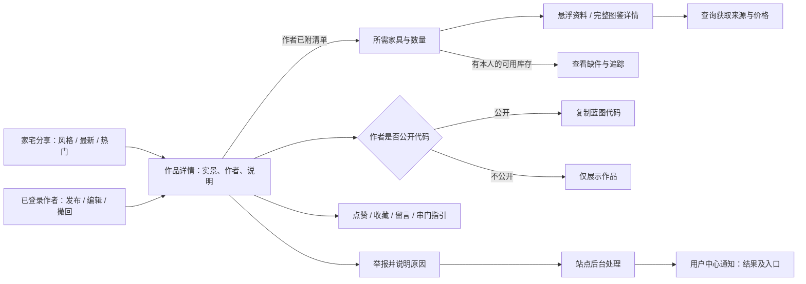

# REQ-203：家宅分享的发布、浏览与互动界面

Written against: `47ad2f915aac1713c0ad085f3303ee2da036de0e`，2026-11-18 工作区。

状态：WP1 实施独立公开作品页和作者草稿。以下审计记录的是改动前的界面，其他工作项沿用原排期。

## 范围与证据等级

本轮名称由运营明确为「家宅分享」。已授权的范围为：玩家作品图片与说明、蓝图代码可公开或不公开、所需家具及数量、家具悬浮详情与图鉴联动、点赞、收藏、留言、举报及原因说明、站点后台处理、处理结果站内反馈、基础敏感词库、热门作品榜、风格分类和串门入口。此范围按本轮最新对话覆盖旧《家宅内容推荐-范围核对》里“评论等尚未确认”的记载，不能再引用旧文档把已授权的能力排除。

暖房活动的组织、报名、签到和活动日历仍是候选，未确定机制。新增的社区入住数、房屋及阵营地图动态查询同样单列候选调研，不改变当前排期。关注、私信、付费作品、个性化推荐算法、REQ-200 图书馆整套投稿系统、REQ-202 来源搜索、PC 客户端不并入本次。

**2026-11-18 最终入口决定**　作者可在网页只填作品名、粘贴原生码、设置代码可见性，账号提供署名。实景、说明、与这份图纸相符的家具用量可选，允许发布后补充。原生码查询不到明细时仍可基础发布。自愿通过统一插件提供明细的设计见[跨端记录](../docs/统一插件与双向同步-20261118.md)。

- **来源可追溯**：现有页面、样式、访问入口与数据边界均来自下列源码；设计规则来自 `DESIGN.md`、`docs/魔兽管家UI设计规范v2.md`、`docs/UI工作方法-证据规范实现验收.md`、`docs/开发规范.md`。
- **演示数据**：本文中的作品名、图例和数量都只说明结构；实际演示不得伪称真实用户上传或真实热门。
- **暂时假设**：作品详情以独立 hash 子路由呈现；串门先表示作者自愿公开的游戏内访问指引。二者是实现建议，须与主执行者的最终数据契约一致，不代表已验证国服可直接跳转或自动进入住宅。

## Evidence chain：目标页面与代码所有权

| 位置 | 当前事实及运行入口 | 实现含义 |
|---|---|---|
| `index.html:220`，`#iaSubnavHouse` | 家宅房屋二级导航已有图鉴、方案单、社区三个入口 | 将社区可见名称统一为家宅分享；保留既有 `community` 路由键兼容，不另建一套顶级导航 |
| `index.html:946`，`#page-community` | 明确标注三期占位，使用 `.card.home-guide-card`，只有图鉴和方案单导流 | 替换这个获授权的占位面；占位本身不是 BUG，也不声称已有投稿能力 |
| `js/app.js:2394`、`:2686`、`:2766`、`:2801` | 页面名和 `#/house/community` 的房屋分组/匿名访问路由已存在 | 只在这些所有权位置接新挂载与详情路由，不能用公会守卫包住分享 |
| `js/app.js:2619`，`ensureDecorMounted()` | `DecorCatalog.planBridge` 注入账号态、读云端方案、`cloudCrud` 保存及多方案操作 | 共享网站登录和通用保存流程，作品使用独立的写入接口与数据表 |
| `js/app.js:2652`，`ensureDecorPlanPageMounted()` | 先初始化图鉴与 bridge，再惰性挂载方案页 | 作品家具的后续查询直接按图鉴条目读取 |
| `js/decorData.js:1362`，`#dhPpShare` | “分享方案”明确禁用并提示三期开放 | 移除失效的分享占位。作者从家宅分享页面进入自己的作品 |
| `js/decorData.js:236`、`:244` | `iconSrc`、`iconFallback` 是家具图标与兜底所有者 | 作品清单沿用真实图标和缺图兜底，不新建外链拼图规则 |
| `js/decorData.js:394`、`:406`、`:468`、`:476`、`:484` | `priceText`、`sourceText`、`rawSourceLines`、`knownSourceLines`、`renderSourceBlock` 格式化来源/价格/条件 | 对相同家具使用同一资料与格式；多途径不合并为一种价格，不把未知当免费 |
| `js/decorData.js:507`，`openDetail(r, trigger)` | 已有点击家具详情弹窗和关闭后焦点归还；目前是闭包内部函数 | 复用数据与格式化层，为分享提供窄只读接口；新悬浮卡不能复制整份目录数据和格式化代码 |
| `js/decorData.js:1452` 起 `window.DecorCatalog` | 现有公开接口只有挂载/激活、个人上下文同步、方案页与导出脏检查 | **尚无**可供分享调用的条目查询、来源格式化、打开详情公共 API；新增接口必须明确注册，不能假设已有 |
| `js/decorData.js:43`，`SELECT` | 图鉴查询目前读 `record_id`，未读 `item_id`；表本身有 `item_id` | 若导入使用物品 ID，必须先补经过核实的 ID 映射，不以名称猜测 |
| `sql/35_task058_decor_plans.sql` | 方案及明细是用户私有数据 | 新作品发布存自己的家具快照/版本；编辑原方案不能悄悄修改已公开作品 |
| `index.html:2133`、`:2208`；`js/app.js:1235` | 用户中心“通知”标签、徽章、导航未读点、列表已存在 | 新结果沿用一个通知入口，不为家宅再建通知中心 |
| `js/cloud.js:1877`、`:1895`、`:1909`、`:1926` | 通知读、计数与已读操作按账号执行，无当前公会读取条件 | 复用账号收件人模型；新通知必须可在无公会账号查看 |
| `sql/01_tables.sql:147`，`sql/schema_baseline_v1.sql:133` | 旧 `notifications.guild_id` 非空并关联公会 | 新账号级结果通知必须有兼容迁移或单独表后的统一读取；不能填一个虚假公会 ID，也不能仅放宽前端 |
| `css/main.css:4951`；`css/decor-public.css:70`、`:755` | 页容器默认 1400px，图鉴/方案等例外 1600px；现有家具卡和方案表格各自独立 | 家宅分享从现有 1400px 容器开始，按实测决定局部注册宽度，不全站扩容 |

### 已核实的 UI 问题清单

**UI-203-01｜通知请求失败被显示为“暂无通知”（源码核实，尚未浏览器复现）。**

- 合同证据：UI 工作方法 §三要求 `loading/error/empty` 分开覆盖；新举报处理闭环要求用户能可靠感知处理结果。
- 可达路径：用户中心通知 → `loadNotifications()` → `CloudSync.getNotifications()`；后者 `catch` 返回 `[]`，上层 `notifications.length === 0` 输出“暂无通知”，其错误分支不能收到该失败。
- 确定性修正：新统一通知加载契约明确区分成功空数组与读取失败；失败保留已呈现数据并显示“通知加载失败，重试”，没有旧数据时用独立失败块。既有公会通知读取、邀请按钮和已读动作同步回归。
- 所有者：`js/cloud.js:1877`、`js/app.js:1235`。属于本次接通账号级结果通知的必要错误态，不借此扩展其他消息产品。

其他核对项均是新增能力或集成边界，未把它们写成现存 BUG。占位社区、禁用分享按钮属于原阶段明确取舍。桌面优先/移动封存引用 UI v2 §8；不引入动画库、手势和音效引用 §9，均为**已知取舍**，不列缺陷。

## Design decision：从作品查看蓝图与家具图鉴

### 浏览页与详情

1. 主标题「家宅分享」，说明为短句；右侧主按钮「发布作品」。首屏先给作品，不放大幅装饰性 Hero 或教程墙。
2. 工具行包含搜索、风格筛选和最新/热门排序；“我的作品”“我的收藏”作为账号内视图。游客可以浏览，产生个人写入时沿用登录流程并回到原作品。公会角色不影响这些个人能力。
3. 有图的作品卡用真实封面和固定 16:9 媒体框。无图时用作品名与作者展示。仅在作者附单时显示家具数，代码可见性单独标明。点赞、收藏各用独立按钮，详情呈现完整标题和正文。
4. 详情显示主图与缩略图切换，图片有完整查看入口，图像不因适配裁掉不可恢复的信息；正文不支持任意 HTML。真实作者显示名可见，邮箱、登录 ID、私有角色和公会资料不随作品泄露。
5. 详情提供稳定可分享 URL；关闭或返回恢复原筛选、页码和滚动位置。失效、下架、仅本人可见与不存在均给明确页面，不留空白，也不暴露管理原因给无关访客。
6. 家具区分别显示“X 种家具 / 共 Y 件”；每行图标+名称、数量、室内/室外（来源确有信息时）、完整资料入口。未知 ID 仍保留行与数量并显示“待匹配”，清单不完整时明确标记，不能声称全部已识别。
7. 浏览作品与查图鉴均独立于个人采购。
8. 蓝图字段公开与作品公开独立。公开时给复制按钮及明确成功/失败提示；不公开时只显示“作者未公开蓝图代码”。匿名读取不得带原始代码、位置、朝向等可还原布局的数据；前端隐藏按钮不足以实现权限。

### 发布、修改与清单

- 发布入口复用既有账号系统；无公会账号可以发布。表单包含标题、实景图、说明、风格、代码公开设置，以及经过确认的家具清单入口。先声明字段限制，再由服务端校验同一限制；不在 UI 层默默截断输入。
- 图片先预览再提交，显示上传中、失败重试、删除、封面选择；空封面、过大文件、非图片、损坏图片都对应具体提示。上传失败不得清空正文与已成功上传的图片。格式和数量限值由主执行者登记到任务字段契约，本文不虚构现有上限。
- 基础入口粘贴原生码即可，预览中明示清单“作者未提供”。有附单时才启用用量核对，未识别项保留。展示种类、所需件数、个人可用件数与缺件。库存未知时仍可查来源和价格。清单与代码公开开关独立；代码或布局变更后需重新确认明细的版本。
- 解析之后显示识别结果、家具数量、未匹配项；展示原始标识以便核对，名称仅供阅读。保存发布后从数据库重读再更新 UI；双击不会重复发布，失败保留完整编辑状态。
- 从“我的作品”打开作者草稿。作者修改、发布或撤回后，以服务端回读确认结果。
- 编辑器接入 `modalStack`、`modalDirtyChecks` 或统一页面离开保护，取消、遮罩、Esc、切页都保留未保存提醒。图片和清单数组也纳入脏检查，不能只比较文本框。

### 社交、串门、举报与后台

- 点赞/收藏分别显示选中态与无障碍状态；重复请求幂等。请求中禁重复点击，失败回到服务器确认值。收藏是当前用户自己的集合，不默认公开其全部收藏。
- 留言支持正文与发布结果，长文本自然折行、链接不能撑破容器；提交失败保留正文。留言作者可以执行获授权的本人管理动作，站点管理者负责内容处理。首期不由此扩成多层论坛、私信或关注体系。
- 风格是作品级分类；不得把家具的“资料片分类”误叫家具加入版本，也不能自动把单件家具的种族标签当作整套装修风格。先使用主执行者登记的作品分类词表，空分类可展示未分类。
- 热门榜只统计当前可公开浏览的作品。窗口、指标、排序与并列规则需由实现契约写清楚，并在列表注明口径；不能用手填顺序冒充真实热度，不能把去重浏览、点赞数和收藏数混用。没有数据时显示空态，不造榜。
- 串门区只展示作者自愿填写的可公开访问信息及可复制指引；未填、关闭或跨区不可用有明确状态。国服住宅链接是否可直接使用另行验证，不许按钮声称能自动启动游戏或传送。
- 作品与留言可举报；面板显示举报对象、原因分类、补充说明，提交后确认已收到，并能从用户中心跟进结果。不能以删除作品作为举报提交的成功反馈，也不把举报人身份公开给被举报者。
- 后台入口使用站点级管理资格，不能沿用 `guild_members.owner/editor`。队列显示对象、原因、时间、状态和当前处理人；处理页包含原内容、理由和处理动作，危险动作需确认。结果通知只发有关账号，必要的处理原因与敏感原文分开。
- 基础敏感词校验在服务端执行，前端仅提示并保留正文；词库不是合规保证。拦截、待核对、已处理等状态词与后台契约一致。不要把内容下架自动升级为全站封号；封禁/禁言的范围、期限和恢复行为若未在任务中明确，保留为需确定的策略。
- 新通知仍进入现有用户中心。结果包含明确动作、处理时间、必要理由和返回作品/反馈详情的入口。对象已下架时能看到自身处理结果，不跳到死链接。所有用户内容以文本转义渲染，不能直接插入现有 `n.title/n.message` 的 HTML 模板。

## Reuse：继承与需要新增的公共能力

| 复用项 | 现有所有者 | 本轮处理 |
|---|---|---|
| 家宅导航、匿名浏览、账号登录 | `index.html`、`js/app.js` 的 IA 路由 | 复用，不增加公会前置条件；登录后回到触发动作的作品 |
| 作品写入口 | `cloudCrud`、`CloudSync` 与专用作品接口 | 继续唯一主数据源；新作品/互动写点必须登记并经过同等权限与回读 |
| 家具资料、品质色、图标、来源/价格 | `DecorCatalog`、`DecorDict`、`.dh-q0…7` | 新增窄只读门面，如 `ready/getEntry/formatSources/openEntry`；名称为建议，须由所有者统一实现；加载幂等，不暴露可修改全量 state |
| 旧家具点击详情 | `openDetail/closeDetail` | 分享侧传真实 record_id 与触发元素；加单行为仍走原 bridge |
| 悬浮资料交互 | `DESIGN.md` REQ-196 `.loot-detail-popover` 的交互范式 | 只借鉴固定层、避让、键盘和关闭行为，不复用装备 renderer 或复制装备属性词表 |
| 按钮、表单、确认弹窗、标签 | `.btn-*`、`.modal-overlay/.modal`、`modalStack`、`.tag` | 同体系，不创建第二套按钮或原生 alert/confirm |
| 账号通知 | 用户中心 `.uc-notification-*`、`navNotifDot`、`notifBadge` | 一个入口统一公会与站点消息；底层解除强公会依赖并回归老通知 |

家具悬浮卡需要新增，因为目前图鉴只有点击弹窗；共享的数据投影与格式化仍由图鉴所有者提供。建议新模块 `js/housingShare.js` 与局部样式 `css/housing-share.css`，使用 `hs-` 前缀并限制于分享容器/明确的 body 浮层，避免将大型新页面逻辑继续塞进 `app.js`。具体文件命名可以随主执行者模块拆分调整，但数据与格式化单一真源不得变。

## 新组件登记草案与桌面排版

实现前将下表落入 `DESIGN.md` 或专项规范并引用 UI v2。以下是新组件建议规格，不是已存在的 CSS，也不是浏览器已通过的结论。

| 组件 | 建议规格与交互 |
|---|---|
| 分享筛选条 `.hs-toolbar` | 8px 控件间距、换行不挤压按钮，复用注册筛选 chip；状态与结果数常见，不另造吸顶层 |
| 作品网格 `.hs-grid/.hs-card` | 间距 16px，卡片最小约 260px；1366 常见可用宽度约 3 列，1920/1400px 容器约 4 列，以实际壳测量为准；卡片材质用 `--bg-card`、边框 `--border-color`、圆角 ≤8px |
| 作品图集 `.hs-gallery` | 16:9 预览框，主图 `object-fit:contain`，缩略图可裁切；实景图不附臆造的 3D 或自动蓝图预览 |
| 详情布局 `.hs-detail` | 主列 `minmax(0,1fr)`，侧列约 320px，间距 16px；1366 宽度不足时将作者/代码/串门卡下移，家具名称和数量优先完整可读，不出现整页横向滚动 |
| 家具行 `.hs-material-row` | 图标 36px，名称 14px/600、数量 tabular-nums 且不换行；原始 ID/待匹配说明用次级文字；公共详情与方案清单使用相同品质语义 |
| 家具预览 `.hs-material-popover` | 最大约 360px，距视口边 8px，内容过长内部滚动；显示家具图标、品质色名称、所需数量、来源/价格与条件；不复制整张作品图 |
| 互动工具组 `.hs-reactions` | 复用 32px ghost/次级按钮，选中态有文字/图形变化，不能仅靠颜色；发布等主按钮沿用既有 40px 规格 |
| 编辑与举报面板 | 使用现有 modal 材质、栈与防误关；标题/正文/字段错误层级明确。较长发布表单可用专页，避免多重弹窗嵌套 |
| 后台列表与处理详情 | 用现有表格、筛选和状态 tag；原因允许换行，动作列不裁切，处理理由不塞进只可 hover 的内容 |

颜色直接引用现有 token：深色背景与卡片、金色主要动作、语义成功/警告/错误；物品品质用 `--item-quality-*`，不按照装修风格随意改品质色。字体沿用系统栈，正文 13–14px，页面标题服从现有 22px 规则。悬浮只做必要边框/透明度反馈，150–200ms；遵守 `prefers-reduced-motion`，没有常驻飘动、自动轮播或声音。

悬浮预览由图标和名称的 hover/focus 触发；鼠标可以移入卡片阅读，Esc、外部点击、切页与滚动时合理关闭；点击家具打开完整详情。焦点触发时可操作内容必须有可达路径，不能给包含按钮/链接的浮层错误套用纯文本 tooltip 语义。使用真实按钮/链接与可访问名称，弹窗关闭回原触发元素。层级沿项目既有栈登记，不用任意高 z-index 压住通知和模态框。

## 状态矩阵（交付时逐项取证）

| 状态 | 作品列表/详情 | 发布与图片/清单 | 点赞收藏/留言/举报 | 后台/通知 |
|---|---|---|---|---|
| default | 真封面、标题、作者、家具数量、代码权限一致 | 字段说明和当前清单，未伪造解析结果 | 可用动作清晰，游客操作提示登录 | 真实队列、结果和归属 |
| hover | 卡片/家具可读反馈，家具预览可移入 | 按钮和缩略图有反馈 | 原生按钮反馈与标题 | 列表行动明确，不以 hover 藏必要处理信息 |
| focus-visible | 卡片、家具、图集可键盘操作 | 字段标签关联，错误焦点可达 | 有焦点轮廓，按钮无嵌套 | 处理/结果链接可访问，关闭归还焦点 |
| active | 按下反馈，避免整卡误触内部按钮 | 保存/上传动作即时响应 | 按下即响应，不连续重复提交 | 处理按钮去重 |
| selected | 当前风格/排序/图片明显 | 封面、代码公开设置、清单选择可辨 | 点赞/收藏 `aria-pressed` 与视觉一致 | 当前状态筛选与未读状态可辨 |
| disabled | 代码未公开用说明代替无意义复制按钮 | 无效字段/未完成上传阻止对应动作并说明 | 权限/频率限制有原因，不永久无解释禁用 | 非站点管理员不可操作，后台仍服务端鉴权 |
| loading | 骨架或明确加载文案，图片框占位稳定 | 保存中、单图上传中、清单识别中独立 | 单动作加载，不清空留言 | 后台与通知加载独立，无旧结果时不得假空态 |
| error | 失败重试；详情不存在/下架有专门状态 | 保留填写内容，指出无效代码/ID/图片 | 失败保留正文/原因，回到确认过的计数 | 通知失败不是暂无通知；处理失败不先显示成功 |
| empty | 暂无作品/无筛选结果分别给操作 | 无家具/无图/未匹配数据分别说明 | 无留言/无收藏正常显示 | 无待处理/无通知与失败区分 |
| expanded | 长描述、完整图、家具资料有完整入口 | 清单核对明细与未匹配条目展开 | 举报说明和长留言不被截断 | 处理原因和完整内容可看；对象失效仍可看自身结果 |

## Changes：执行顺序与验收点

1. **先确定发布数据与权限**。登记作品字段、可选清单、代码可见性、图片存储、互动去重、举报状态及通知模型。基础发布独立验收，匿名响应按代码公开设置返回，无公会账号也能发布。仅有原生码时可发布、刷新、再补明细。网页单码自动查询保留独立验证。
2. **图鉴共享门面**：在 `js/decorData.js` 暴露窄公共接口并复用现有加载/格式化。验收直接打开作品时可显示家具；价格、替代来源、未知 ID 和品质图标与图鉴一致；原图鉴筛选/翻页/详情/加单不回归。
3. **分享页面与编辑**：注册组件后新增模块、局部样式，接 `index.html#page-community`、`app.js` 路由与登录回跳，提供作者的独立作品入口。验收发布→刷新→编辑→撤回的真实保存链路与编辑离开保护。
4. **社交与后台**：按获授权范围接入点赞收藏、留言、举报、站点处理、敏感词和榜单；串门按核实过的字段展示。验收作者、其他用户、匿名访客、站点管理员四种权限，不能用公会 owner/editor 代替站点资格。
5. **通知接通**：保留现有用户中心入口，为账号级结果调整模型、渲染和动作，修正 UI-203-01；标题、说明、URL 受控转义。验收无公会用户举报收到结果、标已读/刷新一致，既有公会邀请仍可操作。
6. **交付取证**：记录 1366×768、1920×1080 实际页面、按钮、状态和截图；提交文案按运营规范附上，未上线/未真机/待定项分开写，不以自测代替运营验收。

## Validation

- 浏览：匿名直达列表/作品；搜索和风格过滤无结果；长标题、多行说明、缺图、损坏图、超长家具名、大数量、未知 ID；返回保留浏览位置。
- 数据：隔离账号实际发布、修改、撤回、刷新；两个账号切换不串草稿/收藏/通知；访客和他人不能获取未公开代码；不能改他人作品或读管理私有备注。
- 家具：同一条目在分享悬浮、完整详情、图鉴显示相同品质/来源/价格；多来源按途径分列；未识别项目保留；家具数量与作者的作品清单对应。
- 互动：连续点两次、网络失败、重试、并发更新；留言/举报提交失败保留内容；敏感词返回具体可理解提示；处理后通知可见并链接正确对象。
- 后台：只有站点资格进入和操作；重复处理的结果与通知幂等；下架作品不留在榜单/收藏可见正文中；本人仍能获得必要处理结果。
- 视觉：两种桌面尺寸下无整页横向滚动、截断操作列、浮层出屏；键盘可完整浏览与退出；缩略图不抖动，减少动态效果模式可用。移动端全面改版不纳入本任务，已有公开壳的窄屏基础回归按项目规范执行。
- 通知：分别模拟请求失败、成功空数组、已有旧通知时刷新失败；验证错误不伪装为空态。既有公会消息、邀请动作、徽章、未读点回归。
- 仓库检查由主执行者按最终文件落点运行 `node --check js/app.js`、`node --check js/cloud.js`、`node --check js/decorData.js`、新增模块的语法检查及 `git diff --check`。数据库权限与真实浏览器保存不可由语法检查替代。
- 本文审计只完成源码追踪，不声称执行以上产品验收。图片、代码解析和通知迁移要用真实可追溯样本与隔离数据库证明；游戏原生导入效果需单列真机验收。

## Stop conditions

- 蓝图码无法单独取得全部家具时，基础作品仍可展示。清单来源、完整性或所属图纸无法核实时，暂停该明细的确认，保留作品及待核项；只有在用户自愿附单时才提供插件增强入口。
- 公共 API 会返回未公开代码或私有方案、无公会账号必须伪造 guild_id 才能发布/收到结果时，先修正模型和权限，再继续 UI，不用前端隐藏补救。
- 出现需要扩展到关注/私信、暖房活动报名、图书馆或客户端的依赖时，记录候选交运营决定，不提高优先级或捆绑实施。
- 没有隔离数据库或真实浏览器验证条件时，明确缺口，不把纯前端截图当作 CRUD 已通过。

## Design documentation

### 补丁2：八张截图、原位更换与顶部返回（基线 53b0dfb）

| 线上实测反馈 | 当前实现 | 本轮改动及验收 |
| --- | --- | --- |
| 编辑器已选 4/4，第五张无法加入 | 创建和编辑共用 `hbPhotos`，网站和数据库均限制四张，原文件限 16 MB | 调至八张，每张原文件限 20 MB；在旧作品与新建八图作品中验证实际保存和重新打开。 |
| 缩略图只给移除和设封面 | `renderPreview` 直接呈现图片 | 每张缩略图用按钮承接单图更换，提供可见文字、键盘焦点、处理中和待保存反馈。保留位置与封面；取消或失败保留原图。 |
| 详情底部返回链接需滚动才能看到 | `show` 在详情后追加链接 | 将「返回公开作品」用站内按钮放在标题上方，直接打开详情亦可返回公开列表。 |
| 在公开列表查看下一张图必须先打开作品 | `work` 只把第一张挂到 `.hb-cover` | 多图卡片默认展示作者封面，支持点击或横向拖动翻页，显示当前张数。各卡独立，翻看不写回作品，标题保留详情入口。 |

### 2026-11-19 作品创建与访客详情复核（REQ-203 补丁）

- 运营截图与现页一致。创建表单把蓝图码列为必填，唯一勾选项同时控制公开与复制。改为两个开关，只有公开原码时才能开启一键复制；已公开且可复制的旧作品保留原设置。
- 公开详情只有文字和操作。作者可从电脑多选装修截图、预览、移除或设为封面；第一张用于作品列表，详情可逐张查看完整构图。旧作品允许无图，草稿图片限作者查看。
- 验收路径为作者无蓝图发图、保存并重开编辑、访客看封面与切图、分别检查三种蓝图设置、撤回作品。核对孤立测试库的原码与图片读取权限、1366 与 1920 桌面布局。

主执行者实施前登记本文新组件、账号级通知兼容方式、代码可见性、家具清单数量口径与蓝图入口最终决策。实现后同步 `DESIGN.md`、需求台账、四维 changelog 和本任务验收文档；登记交付/提交/部署/运营验收为独立状态。本文不替代这些登记，也不扩大既有提交、推送和部署授权。

### 补丁2追加 · 访客点击后取码

运营截图显示访客可以截走明码，列表和详情都曾随数据返回代码。修改为列表只浏览作品，详情按作者的两项授权开放“复制蓝图码”，点击时单件核对作品是否仍公开及复制权限，以剪贴板交付。在公开列表、详情、复制失败及作者撤回权限后分别核验。原码在作者编辑器可见。
