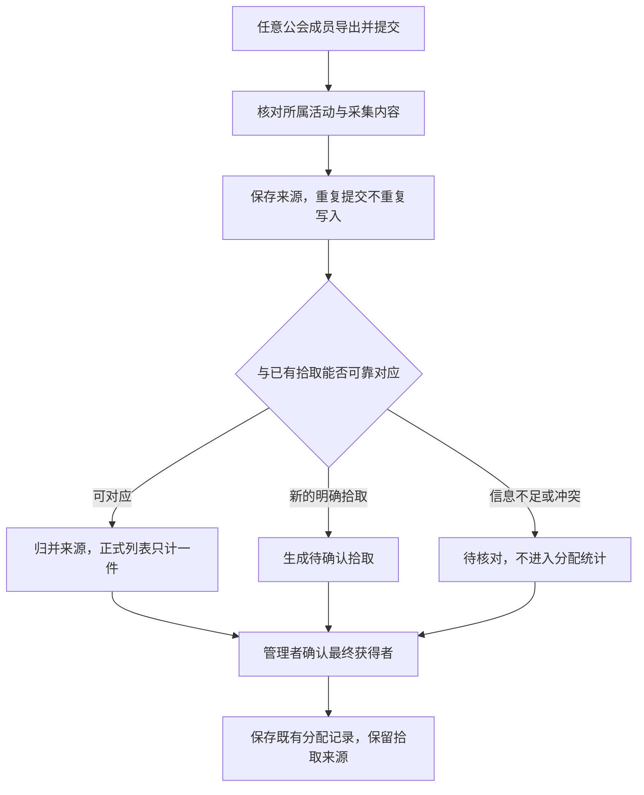

# REQ-191 多人拾取归并与公会权限

2026-11-13。引用《开发规范》；基线提交 `5fe21f1`。数据结构已获运营确认，本块候选136已实现并通过37项真实Chrome与隔离数据库联验，待运营验收，未上线。运营正在开荒，新掉落真机验收暂后置。以下“现状”指改动前基线；实际交付见文末及《REQ-191-交付与验收-20261113》。

## 运营决定

- 同一公会的成员均可提交采集记录，不先指定记录员。沿用 WCL 上传后识别、匹配的使用方式。
- 多人上传同一次拾取应汇总为一条正式拾取；提交资格与最终分配权分开。
- 物品、拾取人、交易对象等信息共同用于匹配；不能只按上传者或同一个日志判定重复。
- 对公会全部功能做角色权限盘点。当前先保证拾取与分配链路，完整自定义角色另分块实施，不默认扩大普通成员的管理权限。
- 新增数据结构已按《开发规范》2.3获运营确认；SQL45先通过隔离验证，后经运营明确授权已于11月13日生产执行；原有业务记录和已安装插件未改。

## 已复核的问题

| 现状 | 结果与边界 |
|---|---|
| SQL42唯一键是公会+拾取人+物品ID+精确时间 | 不含上传者，所以同秒同键可以拦；不同记录者相差一秒会成为两条。没有“多人安装就一定重复”，问题发生在上传后的跨来源识别 |
| 前端仅比较已加载记录 | 同一份导入数组内重复行均被勾选；缓存不含的新记录及并发上传只能依赖数据库兜底 |
| 同键没有难度、服务器、完整物品链接 | 可能误伤真实不同变体；不能通过放宽时间窗口直接修复 |
| 插件剥掉服务器后缀，多件后缀丢弃数量 | 跨服同名与同物品多件尚无可靠区分；后续采集必须保留 |
| 导入映射丢弃完整链接等新采集字段 | 插件已有完整链接，但现有数据库不能用于跨来源核对 |
| 读取loot_drops没有分页 | 默认1000行上限外的历史记录不能靠前端缓存去重；此为源码确认，未实造1001条测试 |
| 拾取转分配尚未实现 | 现有分配表可手动维护，不能描述为已实现自动转换 |
| 当前没有交易采集 | 交易对象只能作为后续证据，不能成为首期导入必填字段 |

证据：`scripts/audit-loot-multi-observer.cjs`直接执行基线5fe21f1导入解析函数，8项历史问题检查；原始结果保存于`evidence/req191-20261113/current-behavior.json`。这是本地合成样本与源码检查，既不是数据库并发实测，也不是游戏真机验收；通过表示复现了旧问题。修复后证据为同目录verification.json。

## 用户流程

插件安装不会自动上传网站；提交时由已登录用户选择当前公会/既有活动。游戏内公会与网站公会不是同一个标识，不能用插件自报公会名称决定数据库归属。多个日志可属于同一活动；日志链接是可选证据，不是必须字段，也不是唯一去重键。

### 识别规则

1. **重传识别**：新版插件每条观察记录保存稳定的来源事件ID，导出、重载、重复粘贴均不变。来源ID用于识别同一采集源重传，不能充当不同客户端共享的游戏事件ID。用户ID、接收时间由服务端填写，不能相信JSON里的上传者声明。
2. **跨来源匹配**：公会和活动范围先一致；再比对副本、难度、首领/击杀场次、拾取者的区域与服务器、物品ID及完整链接中的相关变体、数量和时间。完整链接保留，不能假定不同观察者的原始字符串必定完全相同。物品变体解析规则需测试后启用。
3. **置信度与歧义**：时间接近仅产生候选。只有单一无冲突候选且关键身份/场次字段足够时才能归并；缺服务器、无活动、候选多件、数量不符、变体不同或同一采集源已有另一事件时转待核对。多来源吻合提供佐证，不能证明内容真实或证明公会归属。不得凭多数上传覆盖已有人工结论。
4. **数量守恒**：同一首领同物品可能掉多件。每件实际掉落可有多个观察来源，但一个观察不能无条件覆盖整组。不同拾取者必分开；同人同物品多件需要保留数量/独立实例，不能靠时间四舍五入或简单哈希强行合一。无法区分时让管理者确认数量。
5. **并发兜底**：同活动归并在数据库事务内串行核对并写入；同来源唯一约束处理重试，避免两个用户同时查询“无记录”后各插一份。前端预览只是提示，不承担最终唯一性。
6. **旧记录**：没有来源ID/服务器/完整链接的旧数据保留，标注证据不足，不根据ID猜装等、不自动清理合并。旧版本导出可进入待核对，不能绕过新权限继续直写正式拾取。
7. **交易**：初始拾取和后续转交是两个事件；记录交易成功/取消、双方角色、物品与时间，后续支持连续转交。取消交易不生成最终去向；仅观察到部分交易不能断言最终获得者。缺交易不阻止拾取入库。交易采集的可见范围仍需真机核实。
8. **分配**：一个已核对拾取实例只关联一条当前分配记录；重试不重复新增。确认获得者再写分配，拾取人只能作为候选。分配修正复用原记录，不能新建第二份；撤销关联不删除采集证据。误录删除需有墓碑/忽略状态，避免他人重传将其复活。

### 本期数据结构提案（已确认；下表保留设计意图，实际字段见SQL45）

| 结构 | 最小变更 | 用途 |
|---|---|---|
| 新增loot_drop_observations | id、guild_id、submitter_user_id、collector_source_id、source_event_id、activity_id可空、received_at、captured_at、player_name/server/region、item_id/link、quantity、difficulty/instance/encounter信息、capture_version、校验状态、canonical_drop_id可空 | 保留每位成员的原始证据；唯一键guild_id+collector_source_id+source_event_id，内容不同的同ID拒绝覆盖并提示冲突 |
| 扩展loot_drops | activity_id、player_server/region、item_link、quantity/实例归属、review_status、reviewed_by/at、ignored_at/by；旧字段保留 | 归并后的业务记录，旧行保留原样；旧唯一索引待迁移为新事件约束，禁止直接放弃兜底 |
| 分配来源关联 | 单独关联表或loot_records新增source_drop_id，迁移实现时选其一；同公会校验、唯一关联约束、数量实例化规则 | 保证拾取到既有分配可追溯且重复确认不翻倍 |
| 归并/确认事务 | 服务端专用入口+数据库函数，禁止anon/authenticated直接执行写函数；输入限长、条数限制、服务端鉴权 | 同活动锁、重试幂等、原子保存分配与来源关系 |

初期保留owner/editor/viewer，不新增自定义角色表。普通成员通过专用提交入口写观察记录；不能获得loot_drops/loot_records通用增删改权。若缺活动关联，仅进入待核对；不能由普通成员提交顺带创建正式活动。提交者可看本次处理结果，原始提交数据按最小必要范围读取，不暴露其他用户账号资料。

迁移附唯一索引替换顺序与回滚说明，生产执行前仍须备份和历史行数量核对。回滚应用时暂停新提交，保留新证据表；有新数据后不直接DROP表“回滚”。SQL45已在隔离环境重复执行成功，后经运营授权生产执行并COMMIT，备份与原字段守恒核对见交付文档。

## 公会权限盘点

以下是代码与SQL现状，非本轮全模块实测。通用写代理见server.js authorizeProxyRequest；前端主门为CloudSync.canEdit。WCL专用入口另有wclGuildAuth，不能只改通用代理。

| 场景 | 会长owner | 管理员editor | 普通成员viewer | 后续拆分建议 |
|---|---|---|---|---|
| 公会资料/制度/认领模式等guilds修改 | 可 | 不可（通用代理） | 不可 | guild.settings.manage |
| 授权角色、移除其他账号 | 可 | 不可 | 不可 | 会长保留授权权；本人退出独立 |
| 团队角色成员增改删、离队/恢复、认领审批 | 可 | 可 | 自助认领/解绑/申请窄例外 | roster.manage、claims.review |
| 活动及考勤维护、WCL考勤写入 | 可 | 可 | 只读 | attendance.manage |
| WCL公会绑定/解绑、查新报告 | 可 | 可（专用接口） | 不可 | integrations.wcl.manage / reports.discover分开 |
| WCL活动看板 | 可读 | 可读 | 可读 | team.read；公开战报另立发布权限 |
| 拾取导入与删除 | 可 | 可 | 不可 | 本期新增全成员submit；review与delete留管理者 |
| 现有分配记录维护 | 可 | 可 | 不可 | loot.allocate；不随submit授予 |
| 团队心愿单通用维护 | 可 | 可 | 通用写受限 | 区分wishlist.manage与本人需求；个人入口另核 |
| 仪表盘/统计 | 可读 | 可读 | 可读 | 与所属公会读权限一致 |
| 数据管理导入/清空 | 业务表按管理权限 | 业务表按管理权限 | 无通用写权 | data.import与data.reset分开，危险操作独立确认 |
| 数据中心游戏字典/访问统计 | 不是会长专属 | 不是管理员专属 | 不由公会角色授予 | 产品超管独立，绝不放入公会权限开关 |
| 本人资料、WCL个人授权、个人角色与隐私 | 本人独立管理 | 本人独立管理 | 本人独立管理 | 公会权限不可读取/改写其他人的个人隐私 |

### 后续角色开关方案

- 可显示会长、管理员、成员及自定义角色；例如“考勤员”只开考勤，“装备管理员”只开核对与分配。全体成员提交采集是基础能力，不需为它专设记录员。
- 权限以动作定义，页面入口、按钮、服务端接口采用同一权限词表；保留个人权限/公会权限/产品超管三条边界。
- 第一版一个成员对应一个业务角色，避免多角色允许/拒绝覆盖规则失控。owner身份单独保留，只能由既有安全流程变更。默认角色映射保持旧能力，迁移不悄悄扩权。
- 自定义角色需独立表与成员关联、修改权限的审计记录、缓存失效以及RLS回归；属于后续独立小块，本期不创建这些表。
- 会长管理授权；不能自我提权或给出自己没有的权力。删角色时必须明确成员回落角色，不能因缺配置退回“全权限”。新权限默认拒绝。
- 每个写入口按guild_id判所属；换公会、退出、撤权后重新检查，不能只隐藏按钮。测试需包含直接请求绕过前端。

## 实施顺序与验收

1. 确认本期观察记录、归并记录及分配来源关联的数据变更范围（无自定义角色表）。随后准备迁移、备份/回滚和隔离环境测试。
2. 采集来源/服务器/数量补齐，普通成员提交入口、服务端归并与待核对；复用现有拾取面板，UI实施前补目标页面审计。
3. 用户验收本块；再实施拾取到分配衔接及交易采集，遵守既有分块推进，不能把设计完成算作上线。
4. 全模块角色开关作为独立待办，不让团队收官扩成社交平台权限工程。

必须覆盖：两账号同公会同事件并发提交只计一件；同人重传幂等；相差一秒的跨源样本可候选归并；同首领两件同物品不丢；跨服同名/不同难度/不同场次不合并；离会与跨公会请求拒绝；普通成员可提交但直接删改正式流水或分配被拒绝；伪造上传者被忽略/拒绝；重复确认分配只一份；交易取消/后续转交不误判；忽略项重传不复活；1000行以上仍可查重；写失败重试及刷新一致。

## 本轮交付与限制

- 新增功能：全体公会成员可提交；管理者可核对、忽略、人工合并和更正活动。写入后从数据库重新读取，不以本地预览代替保存成功。
- 功能优化：同来源重传幂等；完整身份、活动、首领场次、难度、完整链接与装等一致的唯一跨源候选在±2秒内归并。同一采集源的另一事件或多个候选保留待核对，不吞掉真实多件。完整链接采用保守逐字匹配，尚未启用变体归一化。
- 修复BUG：BUG-120候选已通过37项隔离联验，待运营验收；BUG-117/118真机复验继续等待新掉落。忽略代替硬删除，完整证据仍在，匹配到同一事件的重传不会恢复误录。
- 模块调整：提交与核对/分配权限分开；完整自定义角色与公会战报维持独立排期。此处核对仅确认拾取事实，不确认最终获得者。

SQL45实际结构：观察表将采集字段存于payload JSONB，另存content_hash、来源/事件ID、提交者、活动及canonical_drop_id；loot_drops记录归并状态、reviewed_by/at、merged_into、observation_count等；loot_records.source_drop_id唯一且限制同公会、已核对、单件来源。审计状态复用reviewed_by/at，不另设ignored_at/by。事务以公会级锁保证并发；普通JWT不能直调函数，观察表RLS仅本人或管理者可读。数量大于1保留待核对，不支持直接生成分配。

Collector仓库候选1.0.5补稳定来源事件ID、角色服务器/区域、击杀场次和数量，按客户端聊天lineID抑制重复回调；该ID不被当成跨客户端共享事件ID。Lua模拟66项通过，不代表游戏真机。没有安装候选，当前游戏沿用1.0.4。

分配来源约束已准备，但“转为分配记录”入口和交易采集尚未实现，留本块运营验收后推进。未提交、未推送、未部署应用；生产SQL45已获授权执行，原业务字段不变。隔离样本3用户/2公会已清理，测试栈已停止。详细操作与发布顺序见交付文档。
