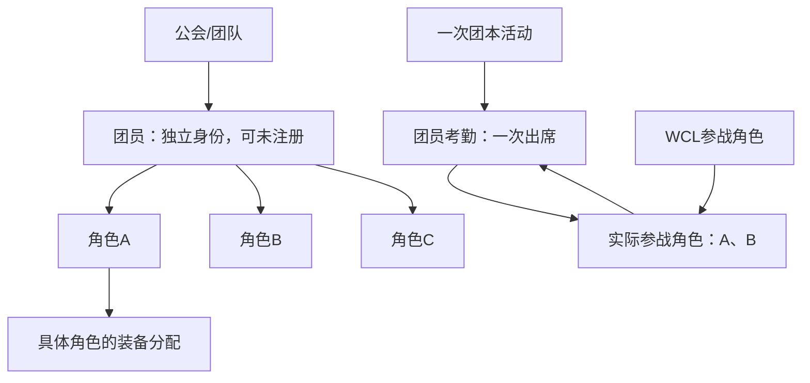

# REQ-195 团员与角色考勤父子关系

状态：2026-11-16运营已确认业务与表结构，并授权与REQ194同时实施、分块验收。已实现并完成隔离验证；后续获生产授权，SQL46结构已迁移，默认legacy暂保旧版兼容，候选139部署后执行46a启用。应用部署和运营验收尚未完成。详见同日生产迁移记录。

## 已确认的结果

考勤关注团员本人。一个团员在一场活动里用主号或小号参战，正常出席只记一次；没有上场的其他角色不产生请假、缺席、迟到、替补。装备仍分配给具体角色。没有注册本站或认领角色的团员也可建立关系。

## 已确认并实现的增量结构

1. 新增 `guild_people`：公会内团员ID、称呼、可空站内用户ID、在队状态。用户ID只作身份关联，不授予公会权限；未注册团员允许为空。公会之间互不共享团员资料。
2. `raid_members` 增加可空 `person_id`：角色归属一个公会团员，外键同时验证公会一致。认领字段 `user_id` 继续表达角色认领，不代替团员关系；已认领同账号的角色可生成关联建议，经管理者确认，冲突不自动覆盖。
3. 新增 `guild_person_attendance`：活动ID＋团员ID唯一、考勤状态、当次参战角色ID/名字/服务器快照、记录来源。按人保存和统计，角色参战证据独立保留。

成员关联操作采用事务：验证当前公会、管理权限、角色归属冲突后一次提交。禁止跨公会合并；viewer只读。关联/拆分只影响之后活动，历史已确认快照不随认领、解绑或转会漂移。

## 界面与流程

- 成员管理保留现有角色资料，新增“关联为同一团员”，可多选主号/小号，一次确认；同账号提供建议，无认领者由管理者指定。不凭相似名字推断。
- 考勤详情每名团员一行，下方列本场实际参战角色；管理员可展开角色、修正实际参战记录。WCL中任一关联角色参战，预览该团员正常出席一次，换号不重复。
- 手动标记只标团员一次；“全部出席”和批量标记也以团员为单位。既有迟到/请假/替补仍适用于团员本人确实发生该情况，不能把未上场小号当成这些状态。
- 仪表盘、活动计数、成员出勤率、排行榜、统计报表和个人认领摘要统一使用同一按团员计算入口；角色行可显示“所属团员出勤率”，不冒充该角色独立出勤。
- 拾取/心愿/装备保持角色维度，继续以角色ID匹配最终获得者。

## 历史处理与兼容

- 原 `activity_attendance` 不批量删改。旧活动默认保留“按角色登记”的历史口径，明确标识；历史转为团员口径需单独预览差异并确认，不能在上线时静默改变已有出勤率。
- 新活动使用团员考勤；缺归属的角色先形成独立团员候选，不自动错误合并。管理者确认关联后再保存本场。
- 混合历史统计明确分开展示口径，不能把旧角色总数和新团员总数直接相加。实现前需将所有统计消费点逐一列入覆盖清单。
- 新表未迁移时入口明确提示不可用，原考勤可继续使用；失败保留编辑，不显示假成功。
- 解绑WCL或站内认领不删除团员、角色、考勤证据；权限仍取guild_members角色。

## 验收门槛

1. 未认领的A/B关联同一团员，A参加→1出席、0缺席；B参加同样结果；A/B都参加仍1出席。
2. 同账号已认领角色建议关联，冲突需确认；同名跨服与不同团员不能误合并。
3. WCL预览、手动保存、刷新、换浏览器一致，取消活动不计出勤。
4. 保存失败不丢表单、不重复；viewer和跨公会写入被拒。
5. 关联拆分不篡改历史快照；旧活动不被静默重算；装备仍归具体角色。
6. 所有统计入口对同一活动得到同一个团员人数与出勤率。

实施顺序已按运营确认调整：REQ194与REQ195并行实施和隔离验证，分别运营验收。生产迁移、提交、部署另按既有授权规则执行。

## 本次交付边界

- 历史活动保持角色口径，未提供历史转换的用户入口；服务端显式转换能力不等于历史转换流程已经交付。
- 新活动按团员登记。未关联角色可一次建立独立团员，再明确关联主小号；保存后的本场名单冻结，补入团员需要明确操作并保存。
- 新团员关系与考勤可以导出备份；现有JSON恢复器尚不能完整恢复，涉及新结构或覆盖现有团员关系时在写入前拦截并解释，不冒充恢复成功。

## 2026-11-16 运营验收补记

用户明确确认“上期任务这一轮主线可以销号，昨天已经测过”。REQ193/194拾取至分配、REQ195团员考勤主线按运营实测验收通过登记；此前待验收表述为历史状态。本次另提无人需求状态，登记REQ198单独验收。此结论不扩为REQ192完整性提示、自动交易或团队阶段全部完成。
