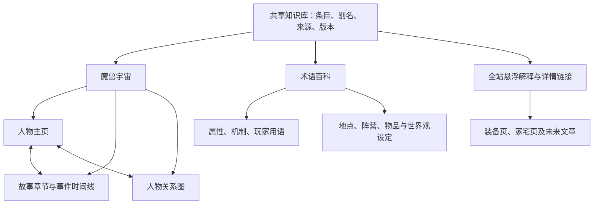
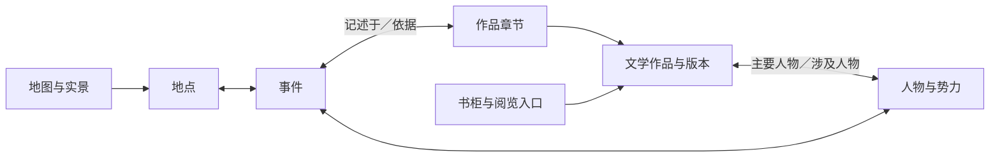
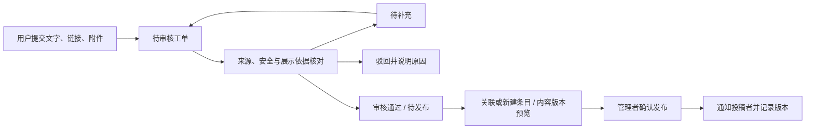

# REQ-200 艾泽拉斯图书馆：魔兽宇宙与知识库范围草案

引用《开发规范》。来源：2026-11-17 运营提出独立内容块。当前仅登记需求、组织结构和建议切片，未实现页面、未执行SQL、未提交或部署。网易DD参考入口尚未提供，未声称核查参考产品。

## 排期与边界

- 2026-11-17运营已选定按原排期推进家宅与休闲；REQ-200保留规划，以下投稿/审核补充不触发本轮开发、SQL或上线。
- 2026-11-17运营最新澄清：前述书柜、四行陈列、独立分区、动效和各类举例属于体验设想，不要求逐项照搬成独立模块；具体结构由实际内容关系、可用资料与可行性验证决定。核心目标是同一图书馆内地图、场景、人物、事件和作品互相联动。保留已明确的地图与交互目标，但未验证的具体呈现方式不当成实现承诺。
- REQ-199团队收官验收等待新CD真实团本样本，保持待验收，不销号；运营明确等待期间允许推进其他任务。
- 本模块独立于个人账号资产和公会内部业务。这里的角色指魔兽作品中的人物，不是用户绑定的游戏角色。
- REQ-178资讯收录继续独立：资讯是文章内容，知识库是可被文章引用的长期条目；未来可接通，不默认恢复全部资讯开发。
- 家宅与休闲、个人剩余环节、公会主页等原候选保留，本次不假定它们全部重新开工。账号安全与PC客户端仍暂缓。

## 模块关系

2026-11-17运营补充：总体定位扩展为可闲逛阅读的“图书馆”，人物关系是其中一个入口；涵盖种族与生物、分支与部族、组织势力、地域分布、武器套装的故事与获取出处。下述早期人物专题建议仅保留为一个候选切片，不代表首期范围已确定。

## 用户阅读路径

搜索人物/别名 → 人物主页（摘要、身份、故事目录）→ 阅读章节 → 悬浮正文关联词获取简短解释 → 点击查看完整条目 → 关系图点另一人物进入其主页。返回应恢复原章节或图谱位置。目录与关系列表作为图谱之外的等价浏览入口。

关系图默认仅展示当前人物及一层关系，按关系类型/故事阶段筛选，主动展开更多；不默认铺满所有人物。边显示关系名称与方向，可点开对应故事依据。敌对、盟友等随阶段变化，不能压成永恒单一关系；平行时间线与不同化身应明确区分。

人物主页含基础信息、带来源的简介、按章节组织的故事、相关事件/地点/阵营、关系列表和图谱。故事章节作为独立内容被多个人物引用，不给每个人复制一篇不同版本的同一事件。

## 词库与解释层

- 统一条目ID、类型、标准名、中文/英文名、别名/缩写、简短解释、完整正文、相关条目、来源、适用游戏版本、最后核查时间和发布状态。这里只是概念字段，非已批准或已执行的表结构。
- 属性/机制与世界观共用检索和引用机制，各自保留不同内容模板。精通等解释需区分通用概念与职业专精差异；数值规则带适用版本，不能把旧版本公式当当前通则。
- 玩家俗称可收录，但不确定缩写先待核实。“丰剑”“MCO”保留用户原文待确认，不擅自改成另一词并发布解释。
- 全站提示展示标准名、简短解释及必要的版本提示，点击进入详情。鼠标移入浮层不关闭；键盘聚焦可读、Esc关闭，浮层不被表格裁切；非悬浮设备仍能点击访问。
- 只在明确接入的展示区标记词条，优先显式条目引用。已有链接、输入框、用户私有自由文本不自动改写；重复词避免每次都高亮。同名多义需要上下文选择，不能靠全站字符串替换决定含义。
- 现有js/lootTaxonomy.js已提供属性等标准名称，可复用名称映射；目前没有可直接当百科用的人物/故事库。游戏主数据仍为装备数值等事实源，知识库仅引用，不另建一份冲突数值。

## 内容维护与质量

首期建议运营维护草稿→核查→发布，公开仅读已发布条目；个人和公会角色权限不自动赋予百科编辑权。条目和关系保留来源及修订信息。世界观陈述、玩法机制与玩家习惯用语分清，矛盾来源明确记载；故事可标剧透范围。

文案以有来源的原创整理为主；引用文字、图片记录来源及可使用依据，不将参考站整页内容直接搬运。不是接入一个API就自动获得完整准确的故事库，需要持续的选题和编辑工作。

## 建议首期：做一段可完整阅读的内容

建议先完成术语搜索/详情/共享解释组件，再选择一个完整专题验证链接与阅读路径。早期提出的同一故事线约5个人物、3—5章、约20个术语为候选A；运营追加种族地理需求后，可用“一个种族→有依据的分支/部族→地区分布→代表人物和相关故事”作为候选B。两者不同时铺开，首期专题尚未确定。关系图首期只做当前条目一层关系和点击跳转；大型全宇宙图、读者自由编辑、评论和个性化推荐后排。

先选可复用现有页面的基础属性词作为接入示例；人物主题待参考页面和素材来源核对后选定。完整视觉原型开工前按UI方法进行审计；本草案不是UI审计或开发交付。

## 首期验收目标

1. 免公会身份可读公开内容，名称/别名可搜，同名多义可区分。
2. 人物、章节、关系和术语之间链接有效，刷新直达、浏览器返回正确。
3. 悬浮与详情读同一条目，修改发布后不出现两套解释；缺词不展示编造内容。
4. 关系有阶段/方向/来源；图谱与列表结果一致，大图不阻塞基本阅读。
5. 草稿不公开，非内容编辑者不能发布，旧版本规则明确标注。

## 待补参考

运营提及网易DD的人物关系页面：需要确切链接以核对其页面结构与交互。模糊术语原文需在正式建词条时确认。这些不阻碍本次概念结构登记，但不据此猜测参考站实现或词义。

## 运营提供的四张参考截图

2026-11-17已保存原图并校验复制文件一致，路径为 `docs/evidence/req200-20261117/reference-01-relationship-map.png` 至 `reference-04-chapter-video.png`。参考图来自运营提供的界面截图，仅作布局与交互意图参考，未提取其中人物头像、背景或视频作为产品素材。以下以截图可观察状态为限，尚未打开原站实测。

|参考|可观察内容|本项目建议承接|
|---|---|---|
|01 关系画布|以阿尔萨斯为中心的人物头像、连线、章节节点；搜索、剧情导览、音乐及重置入口|人物主题专题入口；默认突出当前人物的一层关系，搜索定位；关系类型可筛选，提供文字关系列表|
|02 人物侧栏|选中人物与关系连线高亮，右侧头像/称号/阵营/种族形态/简介/关系列表，语音和视频入口|侧栏快速浏览，另有可直达与分享的人物详情页；关系说明关联故事章节；未选节点弱化但仍可辨识|
|03 章节导览|第1/6章、标题/摘要/涉及人物、前后章、自动播放及翻页看漫剧入口|优先人工前后翻章与章节目录，随章节突出涉及人物；保留阅读位置与退出回图；自动播放后排|
|04 章节视频|视频封面、播放入口、返回章节与下一章|章节可选关联视频或漫画，无媒体时仍可完整阅读；来源和使用方式明确后接入，不依赖每章都有视频|

建议把“自由探索”和“按章阅读”作为同一专题的两种入口，共用人物/章节/关系数据。章节阅读不要求先懂人物关系图，图谱也不能成为唯一导航。词条悬浮解释贯穿人物简介、关系说明和章节正文，并可被既有装备/家宅页面引用。

视觉设计前待核：大画布打开右侧栏后节点是否被遮挡、标签重叠与细线对比度、选中状态是否仅靠颜色、键盘和返回操作。这些是截图引出的审计问题，非已复现的参考站缺陷。关系应显示清楚的文字标签，背景装饰与连线不能压过正文阅读。

## 图书馆扩展：生物、种族、部族与地域

运营补充已确认纳入需求：除人物外，还需种族/生物图鉴、种族内部不同分支及部族、势力和地图分布；武器、套装、物品的设定来源及故事出处也应可查询。DND怪物手册和怪物猎人仅作为组织和阅读体验的类比，不据此给魔兽物种添加弱点、肉质、部位破坏或素材掉落规则；不将类比写成魔兽设定事实。

### 分清条目类型和关系

|类型|记录内容|关系边界|
|种族/生物类别|名称、别名、外形特征、起源、文化/生态、有依据的特性|设定中的种族分类与游戏中的生物类型分开，不强制每类都是严格生物学分类|
|分支|有明确来源的分支、变体或文化分群|分类依据明确；不能仅因名字或配色不同就认定新分支|
|部族/氏族/聚落群体|自称、领袖、成员构成、活动时期、据点、相关事件|部族是社会群体，不必等同生物学亚种；允许多种族成员|
|组织/势力|成员群体、领袖、政治关系和阶段变化|一个种族不等同一个阵营；政治归属与血缘分类独立|
|地点|世界/大陆、区域地图、子区域、营地或据点|地点层级独立，允许同名消歧；游戏地图ID与世界观地点ID关联，不混成一个名字|
|分布记录|哪个群体在何处、常住/活动/历史出现、来源与适用时期|群体与地点多对多，故乡、当前分布和历史活动明确区分|

种族页可查看分支/部族目录、地图分布、代表人物、文化生态及故事；部族页展示其成员构成、领袖、活动地区、势力和事件。地区页可反查当地群体及相关内容。由角色关联部族、由部族关联种族/势力/地图，形成双向浏览。

### 地图粒度和版本

可表达“某张地图→某子区域→某营地”，只在有可靠数据时给坐标或范围。地图单位ID、坐标系与地图版本须对应；NPC单次出现点不能推导整个部族领地；范围不明用地点清单，不画虚构边界。需要区分当前分布、历史迁徙和任务阶段出现，正式服/怀旧版本及平行时间线不混用。

2026-11-17运营进一步明确：地图是图书馆必备核心模块，覆盖游戏内二维地图、高清浏览与游戏内三维实景切换，以及共享坐标定位。此决定覆盖此前“地区目录先行、互动地图后加”的范围建议；地点目录仍保留为等价查询入口，但不能据此宣称地图已交付。运营举例的具体鱼人分支名称待来源核实，不按语音转写猜测收录。

### 生物手册与装备条目

生物手册可展示外形、栖息地、行为、文化、能力、已证实的特性、代表个体与相关故事。若来源明确提及惧光、畏火等，记录原出处、描述对象与适用范围；个体特征不能外推整个种族。世界观描述与实际游戏机制分区：小说描述不能自动变成可利用的游戏伤害加成，旧游戏或官方授权出版物的规则也不直接当作当前正式服机制。资料缺失显示未收录，不填“没有弱点”等无依据结论。

武器/套装条目同时承接故事身份（制造者、历任持有者、事件、设定出处）和游戏物品（版本、物品ID、获取途径）；同名物品不同版本可能对应多个游戏实例。数值和掉落引用现有装备字典，剧情正文独立维护；世界观中的诞生/持有与游戏里的掉落/获取分开说明。

### 每条重要陈述可追溯

特性、关系、分布和故事事实都可挂来源，而非仅在整页末尾附一个笼统链接。记录书籍/版本/章节或页码，或游戏任务/文本/地图及核查版本；官方原作、授权出版物和二手整理区分来源类别，有冲突保留说明。核查前内容保持草稿，不用未知细节填满版面。

追加验收：同一部族多地点、多部族同地区、多种族组织均可正确表达；地区反查与种族页结果一致；缺少坐标不伪造点位；历史分布不误标当前；特性原文与实际玩法机制不混淆。以上为范围与概念模型，未创建数据库表或产品页面。

## 地图核心模块（运营追加范围）

### 三类呈现共用地点与标记

1. 游戏内二维地图：按世界/大陆/区域/子区域浏览，支持缩放、拖动、搜索与点选条目。
2. 高清地图：核实原始地图素材的实际分辨率，提供放大细节与分级加载；优先作为同一二维地图的高清图层，不重复维护一套坐标。不能将低清图简单放大或生成猜测细节称为准确高清地图。
3. 游戏内三维实景：目标为与二维对应的地区实景查看，保留当前选中地点与条目。数据来源、场景导出完整性、浏览器加载、坐标对应及素材使用方式须专门调研后选型。静态截图、全景照片、自由浏览三维场景是不同能力，不能以截图轮播代替用户要求的三维地图。

目标交互：二维选中族群分布或地点→打开条目→切实景查看相应位置→回二维仍保留选择、筛选与地图视野。若某地区暂缺实景数据，明确显示未覆盖，不跳到无关场景。大范围族群分布切实景时仍显示范围语义，不把区域中心冒充实际刷新点。

### 坐标与证据

概念模型包含地点ID、游戏地图ID、适用游戏版本/世界阶段、二维位置、三维位置（可空）、分布几何、来源及精度。字段和表结构尚未实施。界面可使用熟悉的地图X/Y百分比，但必须绑定具体地图；不同地图的同一对数字不视作同一点。二维百分比与三维世界坐标不能直接等同，需逐地图核查变换与误差。室内楼层、地下空间和副本单独标识，避免把不同高度/地图位置压成同一处。

地图与故事时间线分别记录：世界观时期、游戏版本和任务阶段不是同一个字段。地点改名、地形变化、政权更替需能展示适用时期；王国、势力和地名通过关系链接，不能因名称相似直接等同。运营举例的地名仅作为需求例子，本轮未核实具体历史疆域或出生地事实。

### 可开关的内容图层

|图层|表达|约束|
|地点与人物|城市、据点、出生地、历史活动地点等点位|出生地、居住地、死亡地、曾活动地使用不同语义与图例|
|族群与生物|单点、多个观察点、活动范围或已知分布区域|实测出现点、资料记载分布、推测范围区分，未知不画精确范围|
|势力与王国|领地、控制区、争议区与历史变化|生物分布不等于政治领土，需来源与时期；无可靠边界用区域归属说明|
|故事与事件|事件发生地、路线与相关章节|路线可选；无路线证据不连出虚构路径|
|装备与物品|与地点有关的获取途径和故事出处|故事持有地点与游戏掉落地点分开，引用现有物品数据|

点选标记或范围打开摘要，悬浮可预览，点击详情跳转知识条目；条目反向“在地图中查看”。多点重叠时聚合或展开列表，缩放按层级收敛；图例解释点、区域及来源精度，不只靠颜色区分。图层组合与文本检索应可同时使用。

### 实施前需取得的依据与验收门槛

- 先用一个真实区域做技术验证：可用二维原图/高清素材、三维地形与必要模型纹理、位置对应、不同任务阶段，以及网页加载成本；不能仅因已有单物品模型导出能力就推定整个地区场景可完整导出。
- 三维具体形态和覆盖范围待验证后形成可评审方案；当前不承诺全世界完整三维，也不擅自从范围中删掉三维目标。
- 验收需包括地图缩放/搜索、不同类型点位与范围、地区反查、条目跳转、二维/实景同地点切换、返回保留视野、地图版本与楼层区分；坐标校准用多个已知地标交叉核对，具体误差门槛在技术验证后确定。
- 大地图载入、重叠标记和缺资源状态需真实浏览器实测。数据管理入口、内容编辑权限、地图素材管道及增量SQL须在实施任务书明确；本轮仍只有需求整理。

## 地标、事件与探索动效（2026-11-17运营追加）

运营强调交互与动画演示是本模块的重点体验要求，不能只交付静态地图和文字列表。城镇、城市、伐木场、塔楼、矿洞、任务地点、历史事件发生地、组织常驻据点均可作为地标；关联地点条目，不另建互不相通的地标资料。用户举例的名称、所属地图及具体事件仍须核实，语音转写不直接当标准地名。

### 地标内容与阅读路径

地标摘要包含标准名称、类型、所属区域、简述及有依据的代表事件；展开后展示事件时间线、相关人物、组织/势力、关联任务、实景入口及来源。组织驻扎、领地控制、人物活动分别标记关系和适用时期；事件与地标允许多对多，一个事件跨地点发生时复用同一事件条目，地点仅保存参与关系。有地点但尚无已核实事件时，显示“相关事件待收录”，不等同于从未发生事件。

目标链路：地图定位→悬浮地标预览→点击固定右侧详情→选择历史事件→高亮相关地点/人物/势力→进入故事或实景→返回原地图位置。正式原型需验证地图与关系图切换的上下文保留，不能把政治边界、地理路线、人物关系线混作同一种连线。

### 交互与动画意图（待原型验证，不是已实现规格）

|用户动作|呈现与反馈|阅读约束|
|悬浮/键盘聚焦地标|标记点亮，出现短摘要；可采用右侧预览区或锚定气泡，原型比较后选定|短延迟防掠过闪烁；移入卡片仍可操作，Esc可关闭，快速切换不显示旧条目|
|点击地标|锁定选择，右侧展开完整详情，地图视野为面板让位|悬浮其他点不覆盖已固定详情；点击空白或关闭按钮明确退出；保留返回位置|
|切换事件或故事章节|相关标记与关系线依次强调，可短程平移定位事件发生地|动画表达本次变化；仅有来源的路径才显示，不凭动画编造事件顺序或行军路线|
|鼠标移动于地图背景|装饰底纹、雾层或符文做轻微分层视差，增强空间感|二维地标与底图坐标始终一致；正文与可点击目标不追逐鼠标，拖图时不叠加干扰位移|
|缩放、图层切换、展开关系|标记聚合/展开与连线出现有连续过渡|避免标签碰撞，不阻塞下一次操作，不以等待演出才能阅读|

视觉方向：符合魔兽高魔世界的古地图、档案、金属刻线与克制符文光效；具体材质和配色由视觉原型确定。运营提及国产二游官网与育碧游戏UI作为交互节奏和空间层次参考，不要求赛博朋克风格；本轮未打开这些产品核查，作品名称按用户意图保留，不宣称已复刻或实测。后续采样原站应记录确切链接、动作和观察结果。

动效纳入原型与验收主项，不作为最后随意添加的装饰。提供减少动态效果选项并尊重系统偏好；弱化/关闭视差与自动镜头后全部内容仍可访问。默认无强制自动播放或声音；后台停止持续装饰动画，重图层按需加载。实现遵循项目零构建与动画库约束；具体时长、幅度、性能门槛经原型测量再确定。

追加验收：悬浮→进入浮层→点击固定→阅读事件→返回地图完整路径；快速扫过多个地标无闪屏/串内容；边缘卡片不裁切；面板展开不遮挡选中点；缩放拖动后标记定位正确；键盘等价操作；减少动态效果下仍可完成全部阅读。当前只更新范围文档和台账，无页面代码、SQL或部署。

## 文学作品与全馆联动（2026-11-17）

### 一个知识体系，多种探索入口

文学作品纳入共享知识库，可有书柜/阅览场景，但不要求新增独立一级导航或另建内容系统。地图适合按地点探索，人物关系图适合按人物探索，书柜适合挑选原作，时间线适合按事件阅读；四者展示同一套有来源的关系，切换保留人物、地区、故事时期与阅读位置。界面彼此关联，资料不复制成多套。

建议先验证一个小闭环：一部可查官方来源的作品、其中一个章节、一处地点及相关人物。成功标准是从地图找到作品、从作品回到事件与人物，返回恢复原上下文；书柜动画与大规模书目后续围绕此链路深化，不用大量孤立内容掩盖关联缺失。

### 书柜与排序

- 收录类型可含小说、短篇、漫画与有声故事；编年史/设定集可作为文献类型，不强称全部为小说。用户提及《上古》三部曲、《阿尔萨斯》《狼之心》及麦迪文等人物相关作品为候选，具体书名、译名、版本及关联人物需逐项核实。
- 书柜可按故事年代、人物专题、系列或出版顺序重组。同一本作品关联多个人物，多个入口共用一条作品资料；“主要人物”“参与人物”和“被提及”分级，不能因为出现姓名就当该人物传记。
- 黑门纪年用于有依据的故事时期，不与出版日期混用。跨时期作品记录区间及章节时期，穿越/回忆作品保留叙事框架与故事发生时期；具体年代不明标“年代待核”，不编精确年份强行排序。系列内部顺序、剧情时间顺序和建议阅读顺序分别表达。
- 四排书架是构图参考，不作为固定容量或分类规则。可探索悬浮轻抽出、点击展开书籍简介/目录、收回时保留筛选；无封面或图片未获使用依据时保留可读书脊与标题。长标题、键盘操作和减少动态效果均可完成相同选择。
- 作品详情含作者、原名/译名、类型、系列与卷次、语言/版本、简介、故事时期、相关人物/地点/事件、阅读入口及来源。中文、英文、修订/再版作为作品的不同版本，章节和引文定位绑定版本，不能混用页码。

### 原作、百科与阅读方式

百科事件摘要和文学原作章节是不同内容：本站整理事件时关联原作依据，不把整理文假称原作全文。原作章节与此前人物专题中的导览章节也区分标识；跨页点击的准确粒度取决于来源是否支持章节链接，无可靠定位时进入作品详情，不能声称已定位原文页码。

书籍可以入目录，不要求先拥有全文。收录方式分为：已确认可在本站展示的全文、官方在线阅读/PDF入口、出版商正版购买/试读入口、只有书目信息。网上存在电子版不是本站转载许可；未确认全文使用范围时先提供书目、原创导读、人物地图关系及官方入口，不下载传播来源不明的整本文件。官方免费阅读同样不自动推定允许本站镜像或翻译；封面、译文与音频使用依据分别记录。

### 本轮已核实的官方入口

- 暴雪的[短篇故事汇总](https://news.blizzard.com/en-gb/article/23529006/blizzard-short-stories-hub)确有魔兽故事分类，可作为书目发现入口；其中老链接仍需逐项检查，不把汇总存在当成全部可读。
- 国服官方[《核心领土》](https://wow.blizzard.cn/news/24158486/)提供五章简介及各章PDF阅读链接；第二章“昔日回声”简介涉及萨尔、吉安娜和激流堡。这可作为“地图地点→事件→作品章节→人物”的真实资料候选，当前只核了官方页面，未把全文复制进仓库，也未核地图坐标或完整章节页码。
- 国服官方[《卡雷什的毁灭》](https://wow.blizzard.cn/news/24213957/)提供阅读入口及章节简介，可作为另一个文学条目候选。
- 国际官方[《Heartlands》](https://news.blizzard.com/en-gb/article/24158486/delve-into-the-war-within-with-the-audio-novella-heartlands)包含分章音频嵌入与PDF链接，说明同一作品可关联文字和音频呈现；中文全文/国际音频语言不能混淆标注。

以上为2026-11-17网页核查与产品规划，不代表已取得全文、封面或音频站内使用授权。出版商书目代表样例另见《REQ-200-文学作品官方来源核查-20261117.md》。本轮未改页面或数据库。

### 联动验收方向

1. 地标详情能列出有依据的相关事件与作品章节；作品详情能反查人物、地点与事件，双向结果一致。
2. 同书多人物、多地点不重复建书；同作品不同语言/版本不串章节与页码。
3. 故事年代、出版顺序和人物筛选可解释，年代不明与跨时期作品不伪造精确排序。
4. 外部阅读入口明确语言与阅读类型；失效链接、仅试读、没有全文均明确反馈，不显示虚假的“站内阅读全文”。
5. 书柜、地图、时间线与人物页之间返回保持上下文；动效关闭不影响完整阅读。

## 阅读中的知识联动与无损返回（2026-11-17运营补充）

运营以小说正文中的瓦里安、暴风城、萨拉麦尼为例，明确需要正文词条解释、深入查看与返回继续读的闭环。这些是交互例子；人物标准名与别名、武器起源和历任持有者、事件先后均须单独核实，不将口述直接录成世界观事实。目前已有游戏装备字典，但完整人物、文学、地理知识库仍在规划中，不宣称已经建成。

### 阅读时的三层深度

1. 轻量预览：正文中已关联的名称用克制下划线/标记提示；悬浮或键盘聚焦显示名称、类型、简短简介及可用的小图，不打断原文阅读。人名、城市、武器共用解释组件，按条目类型展示各自内容。
2. 就地查阅：点击可固定侧栏，查看人物身份和相关经历、城市位置与相关事件、武器设定出处及传承时间线。侧栏可继续打开关联条目，并可逐级返回；未知资料明确待收录。
3. 深入探索：主动进入人物主页、地图或物品故事页，提供“返回阅读”入口。保存作品版本、章节、段落锚点、段内位置和阅读视图状态，返回精确恢复，不只回书籍首页。页面刷新后恢复同样需验；源内容修订使锚点失效时明确提示并回最近有效章节，不悄悄跳错段。

### 原文标记与故事上下文

- 正文名称关联共享条目ID与本段所处故事阶段；不为每本小说复制人物简介。名称相同但含义不同、别名、人物继任称号等由编辑核对上下文，不能全局字符串替换。没有已核实条目时保留普通正文。
- 文学中的武器条目可关联游戏物品，但设定起源、持有者变化不等于游戏装备数值或掉落途径；时间线节点各自挂事件及来源。
- 默认轻预览仅提供不泄露后续情节的身份/背景；完整生平、死亡、后续持有者变化等由读者主动展开并给剧透提示。若原作本身含回忆/穿越，以段落故事上下文而非全站“当前版本”决定简介；未编辑安全摘要时用基础身份，不能假装可自动推断无剧透。
- 同一段落重复名称不全部强调，关联词样式可关闭；“知识链接”与用户划线笔记是不同功能，本次没有据此自动增加云笔记或社交批注范围。

### 阅读来源的能力边界

上述全文内词条交互以可在本站合法呈现且可结构化定位的内容为目标。官网外链、第三方PDF或扫描图是否能逐词识别、定位和联动需逐源验证；不能因为取得阅读链接就宣称所有小说都能在本站加悬浮。只有外链阅读权限时先保留作品目录与人物/地点导读，不擅自代理抓取全文。PDF文本层、扫描/OCR、译本错字和章节拆分属于后续来源可用性核查，未验证不批量承诺。

追加验收闭环：同一章节从人名浮层进入人物页→再查看相关城市地图或武器→返回原小说原段落；悬浮移入不误关、键盘可操作、连续跳转不丢阅读位置；故事早期摘要不泄露后续结局；不同译本、同名条目、链接失效和锚点失效有明确结果。当前为范围与交互原则，未实现阅读器。

## 魔兽语义色、内嵌模型与创作关联（2026-11-17）

### 截图与色彩依据

本轮两张原始截图已入库，复制后SHA256一致：

- `docs/evidence/req200-20261117/reference-05-item-tooltip-colors.png`：可见蓝色物品名、白色基础信息、绿色装备效果与黄色装等文字。
- `docs/evidence/req200-20261117/reference-06-use-effect-colors.png`：可见白色物品名与绿色使用效果。

这些是语义与视觉参考，截图可能包含插件改写，不凭截图抗锯齿像素或肉眼判断确定官方色号。正式实现应记录客户端版本、原始颜色常量或可信数据来源，确认后进入共享语义色表，页面与词条不各自抄一份色板。

运营要求：职业、装备品质及属性/效果信息严格沿用对应魔兽颜色，营造熟悉感；无明确官方对应的术语不乱套职业色或品质色。职业色用于明确职业信息，不因人物外观猜职业；物品名按具体物品版本的品质着色，传说故事中的名剑不因知名度直接归橙色品质。种族、阵营、关系类别与品质/职业是不同语义。

现状核对：`css/main.css`已有八档`--item-quality-*`变量，`js/lootTaxonomy.js`按品质数据附标记，`js/itemQualityData.js`记录客户端物品品质索引；职业色在`js/app.js`有多个局部映射。主属性红绿蓝为既有产品设计，不能标成游戏原生提示规则；`css/main.css`既有不同副属性颜色，分配表与部分效果又用`#1eff00`，存在多种历史口径。REQ-200只登记对齐需求，不顺手全站改色。绿色品质名、绿色效果行也不能仅因都是绿色就认定为同一客户端常量。实施前核对并明确现有产品约定与客户端标准的取舍。

详细属性卡应区分品质名称、基础属性、附加属性、装备/使用效果、需求条件等文字角色；正文知识链接的提示线和焦点状态与语义色并存，避免全文彩虹化。对比度不足优先调整背景、字号或承托层，不悄悄改变已确认的品质色；不可仅靠颜色传达类型。

### 在条目里直接查看模型

人物、种族/生物及物品详情可嵌入同一个模型查看组件，目标支持拖拽旋转、缩放、视角复位，在阅读页面内查看，不以弹出新窗口作为唯一方式。轻量正文悬浮卡先用缩略图，点击展开条目后按需加载模型；避免经过多个名称就同时加载多个三维场景。展开全屏可选，不作为默认必经步骤。

模型资源与条目分开关联，记录对应版本、模型身份、贴图/外观与姿态。种族页展示的代表模型必须标明只是样例，不等于所有个体；同一人物不同时期的外观、装备组合需有依据。拖拽和页面滚动不冲突，控制按钮/键盘可操作；模型加载失败保留介绍和准确静态图，说明未能加载，不能用图片冒充可交互模型。

已验证基础仅限历史任务#84：部分本机家具模型导出与静态缩略图已实现，见《TASK-083-084-收尾报告-20261102》。它不能证明人物骨骼、动画、换装、粒子特效或全部生物可完整显示，也不是已有线上交互查看器。后续先选一件物品、一类生物和一个人物进行模型/纹理/姿态完整性与内嵌操作试点；动画和换装是否开放以结果为准。模型来源/使用依据、页面性能与第三方查看器或自有管道选型另行核实，遵守项目依赖评审规则。本轮不改游戏文件或增加网站运行库。

### 同人创作融入条目

创作展示作为人物、种族、职业、地点等条目的关联媒体，也可在全馆集中检索；一件作品涉及多个条目时复用同一作品记录。官方原画、游戏模型与玩家同人明确标注，不能把同人外观或故事当官方设定证据。

每件作品保留原作者、作品名称、原始发布页、发布平台、关联对象及展示依据；Pinterest转存者不自动当原作者，要追溯原始发布者。署名与原链接是必需信息，但不能替代作品展示许可。[Pinterest官方版权说明](https://help.pinterest.com/en/article/copyright)也要求必要时向权利人取得图片/视频使用许可。

可采用作者投稿/明确允许的展示、平台支持且符合规则的嵌入，或仅保留原作链接；ArtStation/Pinterest/X的具体嵌入能力、原作权限和可访问性需分别验证，不承诺任意链接都可嵌入。保持原署名及水印；撤稿/删除/失效后可撤下关联展示，外部媒体失败不影响知识条目阅读。本轮未抓取第三方作品或联系作者。

追加验收：不同入口相同语义色一致，颜色来源可追溯；品质未知不猜色；模型内嵌拖拽/缩放/复位、版本外观、失败回退与返回阅读可用；同人作品来源和作者清楚、与官方资料分开，跨条目复用不重复维护。当前仅完善规划与证据，无产品代码、SQL、提交或部署。

## 资料投稿、纠错与审核（2026-11-17补充，规划）

运营要求为庞大知识库建立持续补充渠道：读者可以提供遗漏资料、纠正条目、投稿同人作品或补充文学作品线索；管理者核实后纳入图书馆。该流程属于站点内容管理，不沿用公会会长/editor权限，不要求投稿者加入公会。

### 投稿入口与处理反馈

- 图书馆提供“提交资料”，条目页提供“纠错 / 补充资料”，自动带入关联条目；打开投稿面板，支持说明文字、多个原始链接与附件。可提交微信公众号某期文章等线索，来源访问受限时可补标题、作者、日期、期号及相关页截图，不索取第三方账号或登录凭据。
- 建议字段：投稿类型、标题、需要补充/纠正什么、关联条目、来源链接、作者/发布者、出处日期与定位、附件及使用依据。官方资料、同人创作、个人观点分别标记，未证实内容可以作为线索提交，不能直接变成正式设定。
- 上传前说明允许范围：魔兽相关资料、勘误、带出处的线索、本人或有展示依据的创作；禁止无关广告、恶意文件、诈骗/钓鱼链接、违法交易推广、色情内容、侵犯隐私及未经许可的全文转载。资料价值与可公开展示权限分别核查，网上可下载不等于可镜像入馆；小说线索可先收书目与官方阅读链接。
- 第一版建议登录投稿，展示文件类型、大小与数量限制（具体限额实施时确定）；附件先进入私有待审区，不直接公开。服务端验证实际文件类型，扫描风险，审核预览与下载受控；上传失败保留文字与链接，重复点击不会生成重复工单。
- 成功提示“已收到，待审核”，给出工单号与“我的投稿”入口。用户可查看状态和管理者反馈、补充材料或申请撤回；明确提交成功不代表已经收录或上线。

### 内容管理后台与发布

- 专用后台队列按类型、状态、关联条目筛选，展示原文/附件/出处、风险提示、重复投稿或已有条目候选；审查者可要求补充、驳回、通过，记录依据与操作时间。
- 审核通过与发布分开。通过后创建待发布内容或变更草稿，检查引用、版本、地图/人物关联及预览，确认后发布；错误收录支持撤下或回退，并保留审计历史。用户只能查看本人非公开投稿；审核、发布、账号处罚分别校验站点权限。
- AI作为可选审核助手：在授权接入后台队列后，帮助提取信息、查重、关联条目、给出引用与风险建议、生成内容草稿，展示不确定项。外部网页、附件和投稿文字均作资料处理，不执行其指令；自动取链接时限制协议、内网访问和重定向，避免让投稿变成访问服务器内部资源的通道。
- 当前聊天不会自动收到未来网站工单。需要另行实现队列接口/通知或由管理者主动发起审核任务；AI无权凭“已通过”自行提交代码或部署。资料可经内容发布流程更新；确需代码改动时仍走实现、验证、运营验收与部署授权。

### 驳回、限制投稿与申诉

- 驳回须有清楚原因；资料不完整、事实分歧或版权待核通常进入补充/驳回，不自动处罚账号。恶意重复、严重违规可由具备权限的管理者进一步处理，保留证据。
- 将“限制资料投稿”“社区禁言”“整站账号封禁”分开，避免一次投稿处置影响公会权限与个人数据。七天是运营提出的可选时长，不设为所有违规的固定规则；到期恢复、解除处罚、申诉/复核入口与操作日志纳入设计。社区功能未上线时不展示无实际作用的禁言按钮。
- AI或风险扫描结果仅作提示，不单独决定封号；管理者确认具体措施、范围、原因与期限，用户可查看决定及申诉方式。待审附件保留时长、删除及申诉证据策略在实施前定案。

未来验收应覆盖：入口带入条目、上传/文本提交成功与失败重试、本人状态查询、补充后复审、驳回原因、通过但未发布、确认发布及回退、权限越界拦截、重复投稿、恶意链接/附件处理、限期处罚与申诉恢复。上述为规划，不是已实现后台、自动AI审核或上线承诺；继续按原排期推进家宅与休闲。

### 站内信与投稿反馈（同日追加）

运营明确要求用户能感知处理过程，不能只有投稿当时的短暂成功提示。规划纳入统一站内消息入口、未读提示与可回看的通知；以下为待实现流程，不提前声称已接通。

**源码核对现状**：`index.html`已有用户中心“通知”标签、未读徽章及顶部用户中心未读点，`app.js loadNotifications`渲染消息，`cloud.js getNotifications/markNotificationRead/markAllNotificationsRead`提供本人通知读取/已读操作；现有用途主要是公会及认领消息。`sql/schema_baseline_v1.sql`中通知必填公会ID，`server.js`通知写入鉴权亦依赖公会。可复用视觉入口，但不能直接把独立图书馆工单塞入公会通知；需规划站点级通知归属、投稿引用及权限。这里只核对代码，未读写生产或验证线上送达。

| 时机 | 用户看到的信息 | 可执行动作 |
|---|---|---|
| 提交成功 | 已收到资料、工单号、等待审核 | 查看投稿 |
| 待补充 | 缺哪些材料、如何补充 | 返回工单补材料 |
| 驳回 | 结果与具体原因 | 修改后重新提交，或按规则申请复核 |
| 通过待发布 | 已通过审核，尚未公开 | 查看处理进度 |
| 发布完成 | 已收录及贡献内容概要 | 打开对应条目/作品 |
| 投稿限制/解除或申诉结果 | 处理范围、原因、期限/结果 | 查看决定、申诉或恢复投稿 |

入口应在登录后的全站导航可发现，无公会账号也可访问；未读提醒不能只藏在用户中心内层标签。优先沿用现有通知中心并补“内容投稿”分类，是否独立铃铛按实施时导航空间审计确定。点击通知进入对应工单/条目，返回保持列表位置；已读不等于删除消息。私有投稿通知只发本人，不能把附件、审核备注或其他人的身份泄露到公开预览；处罚通知给本人，内部证据只对授权管理者可见。

通知在业务状态保存成功后生成，以工单状态变化的唯一事件去重；失败应能重试补发，不能回滚已成功投稿或提示投稿失败诱发重复提交。每个关键状态一次即可，同一审核中的内部操作不逐条打扰；断线/离线时消息仍持久保存，下次登录可见，站内未读数以全量未读为准，不能仅数最新一页。实时刷新方式实施时验证，不把站内提醒承诺为浏览器关闭后也会收到的系统推送；邮件、短信、桌面推送不在本轮规划交付范围。

追加验收：无公会账号能发现入口；离线期间审核后重新登录看到未读；待补充通知直达工单且可提交补充；通过与发布文案区分；通知生成失败可补发、重复重试不重复通知；标记已读/全部已读与数量一致，其他账号无法查看；通知不可达时仍可从“我的投稿”查询结果。
