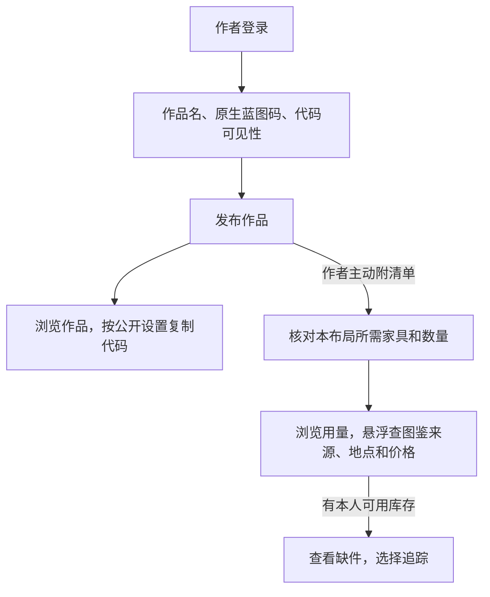

# 家宅内容推荐：现状与范围核对

2026-11-18。**REQ-203 已获授权。基础发布与可选家具明细分别验收，网页按码查询仍待研究。WP1 已进入网页基础发布。公开作品页和作者工作区共用作品记录；方案单只服务个人采购。**

依据原《主线收尾与后续候选》G项，以及运营本轮回复“家宅内容推荐”。引用《开发规范》《UI工作方法-证据规范实现验收》。本次仅核对仓库实现、既有排期与文档，不改产品代码、不执行SQL、不提交或部署。

## 已确认与未确认

- 已确认：继续家宅与休闲；REQ-201/BUG-127可后续统一验收，BUG-127暂缓部署。
- 最新澄清：运营所说的“内容推荐”原本就是玩家装修作品分享。注册用户可分享自己的装修蓝图，选择公开蓝图代码或只展示作品、不开放代码；作品展示所需全部家具和数量，串联现有家宅图鉴的来源与价格，并提供家具清单悬浮详情。
- 原排期依据：任务书#58-WP1将方案单定位为采购计划与组单工具；#58-WP2明确保留“三期社区开放，含蓝图码挂载位”。本轮是在原G项和上述预留方向中澄清内容，不将家具专题、攻略资讯另外排到前面。
- 参考站已补：[WoWDB Housing](https://housing.wowdb.com/)。已读取公开作品、工具说明与家具列表；发布页需要登录，本轮未登录、未投稿，未把公开资料阅读记为真实发布验收。
- 后续明确追加：注册用户点赞、收藏、留言；作品/留言举报、原因与说明、后台接收处理、结果反馈给用户；首版基础词库检查；热门装修排行、风格发现与串门展示方向。关注、私信及完整线下/游戏活动报名系统未默认纳入。排行榜口径、风格维护和后台字段在任务说明中具体化，不以词库替代人工处理。
- 最新流程决定：作者在网页登录，填作品名、贴原生蓝图码、选择是否公开代码即可发布。可自愿补家具清单，统一插件可承接从对应蓝图取明细的增强操作。浏览和基础发布均无需安装插件。
- 待核：网页能否独立由原生码取得家具及数量，以及无效/跨区/不完整样本的处理。运营已提供国服完整布局原生码、五张截图及207条真实内容数据；196种装饰512件全部匹配图鉴，另有7房间、6设施、1房型，共526。当前验证的是游戏缓存清单的读取与匹配；本地短码本身尚未恢复清单。
- 排期保持：REQ-202来源搜索仍为候选待审核；REQ-200图书馆、PC客户端、账号安全不并入本次。新提出的社区入住情况动态查询登记REQ-204调研候选，未列入当前开发排期。
- 原讨论动机：既有用户较多浏览家宅，希望围绕他们的需求扩展。2026-11-10统计报告只是历史观察，不能作为当前访问量或具体家具受欢迎程度的证明。

## 现状核对（源码证据，不等同线上浏览器验收）

| 能力 | 当前实现 | 对本次范围的含义 |
|---|---|---|
| 首页入口 | `index.html#page-home`提供家宅图鉴、方案单等固定入口 | 已有入口载体；尚未确定推荐放首页还是家宅页 |
| 图鉴浏览 | `#/house/decor`，`DecorCatalog.mount`加载只读目录 | 家具内容可复用现有目录，不必复制装备/来源数据 |
| 已有标签 | `js/decorDict.js`定义分类、来源、资料片分类、种族等词表 | 可作为整理家具专题的依据；资料片分类是主题风格，不是加入版本 |
| 获取信息 | `sourceText/knownSourceLines/rawSourceLines`及详情弹窗 | 可继续查看商人、地点、任务和条件；未知信息仍需明示，不能据目录推断当前必然可获得 |
| 个人方案 | 图鉴加单、`#/house/plan`、文本/图片导出 | 有承接用户收藏意向的现成操作；不代表已有游戏内收藏率数据 |
| 方案云端保存 | `app.js`通过`planBridge/saveDecorPlan/cloudCrud`保存个人方案 | 登录后按本人归属保存；推荐内容不应自动写入或覆盖个人方案 |
| 方案公开分享 | `dhPpShare`仍禁用，标题“三期社区开放” | 用户私人方案不能直接当作公开推荐内容 |
| 家宅社区 | `index.html#page-community`为筹备占位卡 | 不能把玩家作品、投稿及评论描述为现成能力 |
| 权限模型 | `sql/35_task058_decor_plans.sql`方案与明细均按本人RLS隔离 | 不应为了推荐绕过个人数据权限 |
| 具体选品与推荐 | 本次目标路径中未发现推荐列表或规则 | 本轮已要求热门作品与风格发现；统计口径仍需定义，不默认实施个性化推荐算法 |

## 三类内容的具象区别

| 类型 | 示例（仅说明形态，不代表已有内容） | 用户得到什么 | 本轮状态 |
|---|---|---|---|
| 1. 家具专题 | “人类风格书房搭配”：编辑整理书柜、书桌、椅子与灯具，逐件说明搭配理由 | 找到适合某种风格/用途的一组家具，查来源并加入自己的采购方案；不保证形成可直接导入的布局 | 仅解释选项，不列为本轮先行任务 |
| 2. 攻略资讯 | “拿到装修蓝图后，怎样查齐家具”：图文说明查缺、查看多种来源、整理采购清单的步骤，文中家具可点开 | 按步骤完成一个家宅操作，了解版本与条件；核心是说明与教学 | 仅解释选项，不列为本轮先行任务 |
| 3. 玩家装修作品 | “作者A的暮色书房”：作品实景、作者说明、蓝图码公开状态、所需家具和数量 | 欣赏具体装修成果，按作者设置获取蓝图，再查家具来源与价格 | 已授权推进REQ-203，原生蓝图可行性优先 |

家具专题与攻略以后可以引用装修作品，作为内容组织形式；本轮不因此新增两条开发线。原代理倾向先做家具专题的建议已被运营本次澄清覆盖。

## 本轮作品分享路径（范围草案，尚未实现）

### 作品展示与代码权限

- 作者署名取当前登录账号。实景图、说明和家具清单均为可选资料，有清单的作品支持先发布后补充。
- “作品公开”和“蓝图代码公开”是两个维度。作者选择仅展示时，访客仍可看作品和家具清单，不能取得原始代码或还原布局所需的位置等完整数据。
- 不开放代码必须由服务端过滤并校验访问者身份；不能把完整代码发到浏览器后仅隐藏复制按钮。作者本人管理与公开访客读取应分开。
- 现有私人方案继续按本人归属隔离；不把保存过的个人方案直接改为公开作品，也不把现有文本/图片清单导出称作游戏蓝图。

### 家具清单与图鉴关联

- 作品用量按类型和家具编号汇总。本人库存另列，具有经核实的可用量时，缺件数取“所需减可用”与零的较大值。未附清单、库存未知、缺零件是三种不同状态。
- 解析应保存蓝图中的原始标识并准确匹配目录；`decor_catalog`已有`record_id`和`item_id`，但当前图鉴查询不读取`item_id`。代码实际采用哪类ID仍待核实，不能只按名称猜测关联。
- 未识别项目须显示并允许核对，明确“清单待补全”，不能静默漏掉后声称列出了全部家具。房间、户型与装饰若在代码中混列，也需分别识别。
- 来源与价格复用现有图鉴数据，多种获取途径分别列出；无价格/条件未知应明示，不当作免费。单件参考价格与作品数量分开，不把互斥购买途径或不同货币直接相加。
- 悬浮图标或名称显示家具预览：品质色名称、图标、所需数量、来源、地点/条件和参考价格；点击进入完整详情。键盘聚焦也能预览，触屏能点击打开。
- 当前家具详情是点击弹窗，并没有本轮所述的清单悬浮卡；需复用资料和格式化逻辑补交互，不能描述为现成能力。

## 蓝图可行性初核（2026-11-18）

- 暴雪官方《Curse of Ula'tek Housing Updates》介绍游戏内蓝图保存、分享和导入，导入预览包含所需房间与装饰等信息；跨地区分享明确标注不含中国区。官方说明支持该产品方向，但不等于已取得可由网站解析的协议，也不能由此推断国服完全不能使用蓝图。
- 来源：[官方家宅蓝图介绍](https://worldofwarcraft.blizzard.com/en-us/news/24295382/curse-of-ulatek-housing-updates-new-blueprints-pets-and-more-arrive-for-your-home)、[官方更新说明](https://worldofwarcraft.blizzard.com/en-gb/news/24293281)。本轮取得搜索索引中的官方正文片段；页面直接打开返回403，没有完成全文或国服客户端验证。
- 待验证：代码来自游戏原生、插件还是网站自定义格式；包含完整布局还是仅引用ID；是否能解出家具ID及数量；国服/海外、版本差异和无效代码处理。
- 现有方案单采购数据不能自动提供摆放位置、朝向、缩放和染色等布局信息。若样本无法完整解析，需要先提出替代资料链路供运营选择，不擅自把“自动清单”降为人工填写后宣布交付。

## 范围确定后的交付约束

方向已明确为作品分享，后续已获继续执行授权。核实代码来源后形成具体任务说明，明确发布/编辑/撤回入口、内容字段、代码可见性、家具解析匹配、与图鉴/方案的衔接、失效内容处理和逐项验收操作。已明确追加的互动、举报处理和站内反馈应纳入家宅分享的闭环；不能据此宣称REQ-200整套资料投稿、文学收录、处罚系统已一并实现。新增模型、接口、埋点或后台均应明确列出，不能隐藏在“推荐”两字中。

通知应面向网站账号，无公会用户也能收到。现有通知读取按本人过滤，但表结构仍要求公会归属；不能伪造公会ID迁就旧表。复用入口时需明确账号级归属迁移及失败/空态处理。公会会长或编辑权限不能自动变成站点社区审核权限。

开发前需按项目UI方法做目标页面审计；验收覆盖推荐展示、实际跳转、家具详情与加单/导出，以及相应失败路径。若涉及保存，按规范补真实浏览器和隔离数据库主链路验证。本次未进行这些开发或验收。

## 当前待补信息

已收到国服完整布局原生码及五张截图：装饰合计512，所有类型合计526，不能当作512种家具或526件家具。代码24字符，标准Base64解码为18字节；常见解压检查未恢复清单，不据此宣称已证明完整编码格式或绝对无法离线解码。

运营已用两条临时指令回传当前“图纸列表”缓存；图鉴匹配、512/526总数及装饰预算1216均吻合。196种装饰均有现有名称/来源/图标，163种有参考价格；现有目录缺少房型/设施类型，须保留独立分组，不能串配同编号家具。操作见[原生蓝图真机核对](REQ-203-原生蓝图真机核对-20261118.md)，来源见[家宅蓝图格式调研](调研-家宅蓝图格式-20261118.md)。本次没有产品实现、SQL执行或线上验收。

基础发布已解除对网页按码取数的依赖。网页独立查询、作者自愿附单、浏览者库存对照各自记录可用条件，分开验收。统一插件、游戏内追踪与桌面同步的设计和证据见[跨端设计记录](统一插件与双向同步-20261118.md)。

新增社区点子的边界见[社区入住信息调研](调研-家宅社区入住信息-20261118.md)：当前只核数据来源，持续采集和自动同步方式未定；不因此恢复暂缓的PC客户端项目。

运营另授权调研家具3D拖拽预览，目标直接融入家宅图鉴详情，登记REQ-205候选；与作品家具清单可复用图鉴，但不以此绕开原生码取数问题，不自动提前开发。见[家具3D图鉴调研](调研-家宅家具3D图鉴-20261118.md)。
