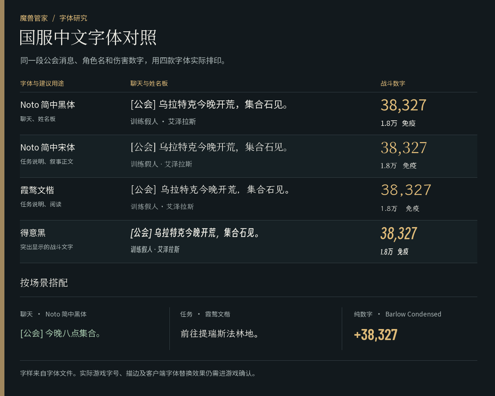

# 魔兽管家能否用网页管理国服字体

2026-11-26 · 可行性调研，供运营决定是否排期。范围为 Windows 国服简体中文正式服。

## 当前评审稿与字体清单

[打开交互稿](evidence/font-library-20261126/font-review.html) · [248 个字体家族清单，含来源、许可、文件指纹与字形覆盖](evidence/font-library-20261126/font-candidates.csv)

**按运营点验修订。** 首次评审时，右侧图片始终显示拍摄时的字体，首屏缺少本地目录入口，覆盖数也需要玩家自己相减。现可在「随字体预览」中切换左侧字体，任务正文、NPC 姓名及伤害数字会在同一背景、相同位置换字。缩略图和放大图均可切回「实拍原图」，保留原始像素作对照。模拟字样由候选字体排印；第三方插件、游戏客户端的缩放、描边和回退仍需实际游戏核对。

首屏提供「选择魔兽游戏目录」识别版本，以及「导入本地字体目录」读取 TTF/OTF 单字体文件。选择本地字体也能看场景、查角色名和缺字数。挑选和预览字体仅需读权限。缺字合计以 **8836 个不重复的测试汉字**为分母，同时列出简中与繁中的缺字数。例：得意黑简中缺 0，繁中缺 1997，去重后缺 1997。常用字表外的名字另计。

### REQ-215 · 应用与删除的本地评审

**11 月 27 日首屏修订。** 原稿打开时默认试排字库第一款 Noto Sans SC。选择游戏目录后，原稿也只查询管家写过的安装记录，对于玩家自己放进去的替换字体，首屏无法回答各用途实际配置了什么。

现在「我的游戏字体」位于候选字库上方，分别展示姓名板与主界面、战斗数字、聊天与任务正文、常规数字、物品与技能说明。每个用途读取对应文件内的完整字体名并使用该文件排样。未选择目录时标为「待读取」，目录中缺少对应文件时标为「游戏默认」，无法识别的文件独立提示。此处反映简中正式服 Fonts 目录配置，游戏插件可另行指定字体。[本机首屏实拍](evidence/font-library-20261126/current-game-fonts.png) · [OpenType 字体命名表](https://learn.microsoft.com/en-us/typography/opentype/spec/name)

首次需选择目录并授予读取权限。再次打开时，浏览器仍允许读取就重新检查文件，权限过期则提供「重新授权读取」。玩家可随时刷新或忘记目录。「读取电脑字体」是单独入口，浏览器允许后可试排 Windows 已安装字体。磁盘已有字体、当前试看的字体和管家上次应用的记录各有明确标签。[Chrome 目录授权](https://developer.chrome.com/blog/persistent-permissions-for-the-file-system-access-api) · [Chrome 本地字体访问](https://developer.chrome.com/docs/capabilities/web-apis/local-fonts)

Chrome 与 Edge 通过系统选择器只读检查本机实际正式服目录，五个用途均识别为 Noto Sans SC Black，与独立读取的字体命名表吻合。切换候选、刷新后自动回读、手动刷新和忘记目录均已验证。Chrome 已授权的系统字体列表在本机返回 216 个字体样式，选择 Arial 后可看场景样张和缺字数。隔离目录复验覆盖默认、损坏文件、应用/删除后更新和授权失效。

原稿首屏只有目录和预览入口。选完字体无处应用，也无法撤销一次替换。修订后在字体名称下常驻「应用位置」「应用到游戏」「删除已应用字体」。选一个用途，确认框显示当前字体、目标文件和操作结果。默认用途为聊天与任务正文，两者共用一个文件。

[查看浏览器实拍的操作区](evidence/font-library-20261126/font-actions.png)。在 Chrome 的隔离目录内，先从作者站点取得并应用 Noto Sans SC，再更换为 Noto Serif SC，最后从该用途删除，三次操作均通过文件回读核对。

- 首次写入已有文件前，在所选 Fonts 内的 WoWButler-FontBackups 子目录保存原件。多次更换字体都可恢复到首次应用前。删除操作针对所选用途，确认框点明要删除的已应用字体。原先没有文件就移除本工具新增的那一个。备份副本保留在本机。
- 预置字体采用清单里实测过的原文件，写入前核对 SHA-256。浏览器取不到原件或作者以压缩包发行时，可从作者处下载，解压后选取对应的 TTF 或 OTF。本地导入的字体直接使用所选文件。「从本地列表移除」只移除本页条目。
- 刷新后在读取权限有效时自动重读同一游戏目录；外部修改与备份记录不符时停止写入。写入、删除与恢复均回读核对。关闭游戏再操作，重启后核对游戏表现。
- Chrome 隔离目录点验覆盖「应用到游戏 → 确认应用」、重复应用、取消、两种用途、刷新后回读、移除本地条目、删除后恢复原字节、移除新增文件、保留外部修改和其他字体、错版原件及拒绝写入。默认 Noto Sans SC 的作者原件已单独在浏览器联网取回并核对指纹。可复跑 `node scripts/verify-font-review-install.js`。游戏客户端内的实际表现待验证。本项为本地评审，无 SQL，待运营点验。

#### 11 月 27 日 Windows 磁盘全流程实测

从本地 HTML 打开评审稿，在 Chrome 158.0.8127.37 和 Edge 158.0.4370.45 中分别通过 Windows 原生目录选择器选中临时的「World of Warcraft」，并在浏览器的读取和写入授权弹窗确认。使用独立目录，实际游戏安装保留原状。

| 玩家操作 | 实际观察 |
| --- | --- |
| 选「聊天与任务正文」，先应用 Noto Sans SC，再换 Noto Serif SC | 两次从作者来源取件，测试程序独立读取磁盘目标文件，两次 SHA-256 均与对应候选原件一致。首次替换前的备份与原件一致。 |
| 刷新页面，重选目录，删除已应用字体 | 两个浏览器都读出已安装的 Noto Serif SC。删除后，预先放置的自定义字体与测试前逐字节相同。 |
| 导入本地字体，分别应用到姓名板与主界面、战斗数字、常规数字、物品与技能说明 | 四个用途都写入对应文件，内容与本地原件逐字节相同。删除后四个新增文件分别消失，原有聊天字体和无关文件都保留。 |
| 对全部 248 个家族尝试获取作者原件 | 本次网络环境下 244 款由页面直接取得并通过指纹校验。得意黑、朱雀仿宋、隨峰體 Plus 走发行包，小赖字体直取失败。四款均重新从作者地址下载并核对，在「选择已下载的字体文件」补入原件后，分别完成实际应用、删除和恢复。 |

另行复跑异常路径，取消、拒绝写权限、选错字体版本和目标文件已被外部修改都保留原文件。以上结论覆盖网页版与磁盘往返；游戏重启后五个用途的实际画面待国服客户端点验。

本次从 Google Fonts 公开目录筛选并逐份读取 240 个家族各一个代表字体，另从中文作者发行包补入 8 个。按家族名去重，常规、粗体、斜体只占一个名额。SC、TC、HK 或等宽版若在来源中作为单独家族发行，保留独立地区或版型名称。这是 248 个候选家族，包含 14 个以简中为主、23 个以繁中为主（含 3 个归入香港类别）、211 个外文家族。简繁归类用于挑选，覆盖数字由实际文件计算。清单中有 243 个 SIL OFL 家族、3 个 Apache 2.0 家族和 2 个 Ubuntu Font Licence 家族，各行附有相应授权。样张由原件排印，评审稿可离线浏览。[Google Fonts 官方仓库](https://github.com/google/fonts) · [Google Fonts 目录](https://fonts.google.com/)

简中检查 GB 2312 一级和二级共 6763 个汉字；繁中检查 Big5 常用区 A440–C67E 解码所得的 5401 个汉字。24 个代表文件全覆盖本次简中测试集，22 个全覆盖繁中测试集，15 个同时全覆盖。这两套样本都没有收全角色名可能使用的汉字。评审稿另外按输入的每个 Unicode 码点查询所选字体、排除缺字占位字形，可以查出两套样本以外的名字用字。「雲梦𠮷」在本次测试的霞鹜文楷中三字齐全，得意黑缺「雲、𠮷」，Noto Sans SC 缺「𠮷」。此检查不代替游戏渲染、异体字序列测试或地区字形偏好。辰宇落雁体的样张在本机排印时出错，单独列为待复核，未计入 248。

任务正文、界面姓名、战斗数字分别提供网页字样与真实场景图。右侧三张参照图分别从 2023-07-16、2024-08-01 和 2024-08-08 的本机正式服截图原像素裁出，均为 640 × 360 PNG。常规桌面页面统一显示为 320 × 180，保留 2 倍像素，并以暗铁内沿、细金边和对角金饰收口。点击可查看 640 × 360 原尺寸，关闭或 Esc 回到原位。后续采样应保持相同宽高比和构图，并以原生分辨率提供至少两倍于缩略图的像素。截图入库应关联字体家族、确切字体文件指纹、游戏构建、场景与界面缩放。未取得对应实拍时显示待采集。本轮三张历史图的当时字体无法核实，统一标为参照；后续按相同任务、同一 NPC 和同一训练场景拍摄可比的字体样例。

聊天预览的普通公会、队伍、团队频道颜色分别为 `#40FF40`、`#AAAAFF`、`#FF7F00`。本机正式服 12.1.5.70961 的 29 份当前角色聊天配置中三色一致，并与插件作者记录的标准色吻合；玩家可自定义颜色，队长、团长发言及按职业着色的角色名另行处理。[游戏界面聊天颜色初始化](https://github.com/Gethe/wow-ui-source/blob/live/Interface/AddOns/Blizzard_ChatFrameBase/Shared/ChatTypeInfoColors.lua) · [公开颜色记录](https://www.curseforge.com/wow/addons/decades-guildops/files/9132158)

## 玩家能得到什么

玩家拖入自己的 TTF，在聊天、任务正文和战斗数字三个样例中比较字号、字形和数字辨识度。满意后可下载按国服约定命名的 Fonts 压缩包；受支持的桌面浏览器还可让玩家主动选中正式服 Fonts 文件夹、授权后直接应用。网页可以在本机完成这些操作。已有作者工具给出了生成 Fonts 目录、放进正式服版本目录的安装路径。[浏览器文件 API](https://developer.chrome.com/docs/capabilities/web-apis/file-system-access) · [字体包作者的安装方法](https://github.com/nowar-fonts/Warcraft-Font-Merger)

| 能力 | 依据与条件 |
| --- | --- |
| 本地字体预览 | 本机 Chrome 和 Edge 已实测 TTF。网页排版适合比较候选字体，游戏自身的描边、字号、缩放与回退字形仍需在游戏确认。[FontFace](https://developer.mozilla.org/en-US/docs/Web/API/FontFace/FontFace) |
| 选择系统已安装字体 | 支持 Local Font Access 的桌面浏览器可另外请求授权。首版从玩家主动选择的字体文件开始，跨浏览器更容易复用。[Chrome 本地字体访问](https://developer.chrome.com/docs/capabilities/web-apis/local-fonts) |
| 应用、备份、恢复 | HTTPS 页面由用户点击目录选择器，获得读写许可后可逐个读写目标文件。下次使用需重新检查授权；目录受保护、浏览器缺少接口或用户拒绝时，保留下载压缩包路径。网页无法静默遍历磁盘定位战网安装或自行提权。[Chrome 文件访问](https://developer.chrome.com/docs/capabilities/web-apis/file-system-access) · [目录选择的限制](https://developer.mozilla.org/en-US/docs/Web/API/Window/showDirectoryPicker) |
| 给第三方插件增加可选字体 | 网页可生成独立字体媒体插件包，用户安装到 AddOns，使用 LibSharedMedia 的插件可在自己的设置中选择。全局游戏字体与插件自带字体的覆盖范围分别验证。国服媒体包需核对中文字符与语言注册。[Custom Font Loader 作者说明](https://www.curseforge.com/wow/addons/custom-font-loader) |
| 游戏内生效时机 | 全局字体首版按“退出游戏、应用、重新启动”设计。PanzaUI 作者在正式服安装说明中明确要求完整重启。每个文件具体影响哪些显示位置，以国服当前构建实测为准。[正式服整合包作者 FAQ](https://github.com/MarioCatuogno/PanzaUI/blob/main/HOW_TO_INSTALL.md#faq) · [游戏主线界面字体定义镜像](https://github.com/Gethe/wow-ui-source/blob/live/Interface/AddOns/Blizzard_Fonts_Shared/Mainline/GameFonts.xml) |

## 对照新手盒子的本地替换

新手盒子正式服的伤害数字字体分享页将安装入口设在盒子客户端。作者说明退出游戏、安装、重启即可使用，并指出若 EllesmereUI 指定了战斗文字字体，需要切回默认「伤害数字」才会生效。由此可以确认盒子支持直接安装游戏字体。公开说明尚未列出用户提到的「插件字体管理器」具体覆盖哪些第三方插件。[新手盒子正式服字体包与作者说明](https://www.wclbox.com/games/1/ConfigureShareItem/54687?version=2)

网页版可设计为首次选择可写的正式服字体文件夹并授权，以后权限仍有效时，每次点一次「应用字体」即可在本机先备份再替换。浏览器可记住所选目录，每次使用先核对权限。插件自带字体也可在其目录获授权、且已核实目标文件时单独替换。例如 WoWeuCN 的作者列出了任务框使用的字体文件名。仅选游戏的 Fonts 文件夹时，权限范围不包含旁边的 Interface/AddOns。[Chrome 目录授权与持久化](https://developer.chrome.com/blog/persistent-permissions-for-the-file-system-access-api) · [WoWeuCN 作者的字体替换说明](https://wowinterface.com/downloads/info25723-questtranslator-chinese11.1.0.html)

## 截图与授权核对

运营提供的客户端截图标题为「魔兽字体好开心」，对应作者的 WoWFontsHappy。截图左侧的操作顺序为选游戏版本、选字体、应用；右侧「共 158 个字体」处于「系统默认」页，Arial 的常规、粗体和斜体分别占位。作者说明该页扫描本机系统字体。这一数字既不代表 158 个独立家族，也不代表 158 款支持中文的作品。此前检查的桌面便携版 WowFontManager 来自另一作者。[WoWFontsHappy 作者说明](https://github.com/huchang47/WOWFontsHappy) · [另一个便携版的作者页](https://github.com/kamusis/wow-font-manager)

竞品将简中分成五个目标文件，写入所选游戏版本的 Fonts 目录。下面是它的映射，具体到国服当前版本和玩家使用的界面插件，仍需逐场景实测。同一文件可影响多个场景，分场景预览时应显示哪些设置会一同变化。[竞品的简中映射](https://github.com/huchang47/WOWFontsHappy/blob/main/src-tauri/src/lib.rs#L833-L844) · [竞品写入逻辑](https://github.com/huchang47/WOWFontsHappy/blob/main/src-tauri/src/lib.rs#L300-L344)

| 玩家想换的字 | 竞品对应的文件 | 适合比较的内容 |
| --- | --- | --- |
| 姓名板与主界面 | FRIZQT__.TTF | 玩家名、训练假人名、界面按钮 |
| 常规数字 | ARIALN.TTF | 血条数字、经验值及百分比 |
| 物品与技能说明 | ARHei.TTF | 物品提示、技能描述的小字 |
| 战斗数字 | ARKai_C.TTF | 伤害、治疗、暴击，与常规数字分别预览 |
| 聊天与任务正文 | ARKai_T.TTF | 队伍对话、任务段落及玩家名字 |

为网站备选的字体按来源分别处理。OFL 1.1 字体可随工具提供，分发时随每份字体保留版权声明及许可文本；如提供修改字库或重新生成的版本，需核对保留字体名称条款和原许可。玩家导入的字体可在本机预览；上架为全站字体需另核再分发权。Windows 自带字体能用于本地显示，并不自动授予网站自托管字体文件或分发下载包的权限。[OFL 1.1 正文](https://openfontlicense.org/open-font-license-official-text/) · [微软字体再分发说明](https://learn.microsoft.com/en-us/typography/fonts/font-faq)

## 本机证据

- 只读检查国服客户端，Wow.exe 产品版本为 **12.1.5.70961**。正式服 Fonts 文件夹已存在，内有 14 个 TTF，包括 ARHei.TTF、ARKai_T.TTF、ARKai_C.TTF。另有 8 个 .slug 和 6 个 .slugo，合计约 905.5 MiB。这是这台机器现有的安装状态，各文件实际用途和游戏内优先级需要单独确认。
- 在本机回环网页使用桌面 Chrome 158.0.8127.37、Edge 158.0.4370.45，分别将现有 ARHei.TTF（10,540,264 字节）交给网页文件输入框。两个浏览器均加载成功，浏览器排版引擎均报告样例使用了该自定义字体。探针页面上传请求均为零，两个浏览器均提供目录选择与文件写入接口。
- 首轮实测覆盖浏览器读取和预览。后续隔离目录的应用和还原验证见上方 REQ-215；玩家授权真实游戏目录和重启游戏后的画面对照待验。

## 首次验证建议

### 国服字体库候选与实测字样

2026-11-26 直接读取候选字体的 Unicode 字符映射，检查 GB 2312 的 6763 个汉字，以及国服聊天、姓名板、任务、伤害、免疫、千分位和百分号五组样本。以下“覆盖”指字形存在于该文件，并排除缺字占位字形。单列五个较少见的人名用字「龘燚喆䶮𠮷」，方便看出同样通过常用字测试的字体之间仍有差别。

| 字体原件 | 6763 个汉字 | 五个较少见字 | 在本次样张中的建议用途 |
| --- | ---: | --- | --- |
| [Noto Sans SC](https://fonts.google.com/noto/specimen/Noto+Sans+SC) | 6763 | 龘燚喆䶮 | 聊天、姓名板和日常界面。样张用 400 字重。 |
| [Noto Serif SC](https://fonts.google.com/noto/specimen/Noto+Serif+SC) | 6763 | 龘燚喆䶮 | 任务和叙事正文，适合喜欢宋体的玩家。样张用 400 字重。 |
| [霞鹜文楷 Regular](https://github.com/lxgw/LxgwWenKai) | 6763 | 龘燚喆䶮𠮷 | 任务正文、偏手写风格的阅读方案。 |
| [得意黑 Oblique](https://github.com/atelier-anchor/smiley-sans/releases/tag/v2.0.1) | 6763 | 燚喆䶮 | 战斗飘字候选。数字和「万、暴击、免疫」可以使用同一字体。 |
| [Barlow Condensed SemiBold](https://fonts.google.com/specimen/Barlow+Condensed) | 0 | 无 | 纯数字对照。数字和所测 ASCII 标点完整；出现「万、免疫」的槽位不推荐整槽替换。 |

另测截图所选的本机 Bahnschrift 和 Cambria Italic，两者对这 6763 个汉字的覆盖都是零。单看截图无法判定用户遇到的每一处异常来自缺字、字体回退还是原始文本编码。正式预览应按文件检查样例字符，再排印它们；发现缺字就列出具体字符。可让玩家输入角色名，提前检查生僻字。完整字库覆盖、客户端识别可变 TTF、字体槽位实际作用、字号描边和视觉效果仍需国服游戏验收。

复核指纹为源文件 SHA-256 的前 12 位，按上表顺序为 a3041811a78c、050080d9255a、2d73eea94ad8、b447d7e781f0、7b619d14bc23。实测只读取字体，样张直接用候选文件排印。四款中文字体均覆盖五组场景样本。

**供运营评审的字体库与布局**。默认显示「精选中文」，按家族计数，粗细和斜体放在家族里。另设「我的字体」供玩家本地导入，使用同一套覆盖检查；字体文件可留在本机。公开库按字体原作者及版本维护许可证、支持的字、文件格式和真机验证状态；预览候选、可下载和游戏已验证可分别标记。为避免每次打开页面就下载多份中文全量字库，字体列表可用固定样字图，用户试用自定义文字时再加载所选字体。

操作沿用「选版本 → 挑字体 → 应用」。在预览上方常驻「聊天」「姓名板／界面」「战斗数字」「任务说明」「整体预览」，选择哪项，就突出哪块原尺寸字样及当前字体。整体页可用同一张国服实景展示整套搭配，保留游戏内字号比例。设置侧栏只显示目标版本和本次应用范围；底层文件名放在高级设置。涉及多个场景映射到同一文件时，同步提示受影响的场景。沿用站内暗底，金色用于当前场景及应用按钮。以上为调研建议，供决定是否排期。

可对照两类已有产品。WoWFontsHappy 用桌面程序自动探测安装路径、浏览系统字体、预览及备份，网页可用一次手选游戏目录替代路径探测。Custom Font Loader 则在游戏中向支持共享媒体的插件注册字体；若考虑这一能力，可按 LibSharedMedia 的语言参数注册简中字体，再在目标插件验证能选中。[WoWFontsHappy 作者说明](https://github.com/huchang47/WOWFontsHappy) · [LibSharedMedia 作者 API](https://www.wowace.com/projects/libsharedmedia-3-0/pages/api-documentation)

先取一种许可明确、可显示简体中文的静态 TTF，将改动限制在一个已核实的文件名。临时目录先验授权、备份、写入、回读和还原；游戏端再对照同一段聊天、任务正文和战斗数字截图。分别记录哪些位置随文件变化、哪些仍由插件控制。

用户原本可能已有自定义字体。“恢复上次方案”应还原替换前的字节；安装前不存在的目标只撤销本工具新增的文件。若文件后来被其他工具改过，应提示后再处理。备份清单只覆盖本次涉及的文件，保留其余字体资源。可供下载的预置字体单独核对再分发许可；玩家自带字体可留在浏览器内处理。

产品建议先验证 **国服字体预览与可逆替换**。如果用户确实需要把同一字体带入姓名板等插件，再决定是否增加兼容插件的媒体包。此调研未变更个人档案或桌面端排期。
